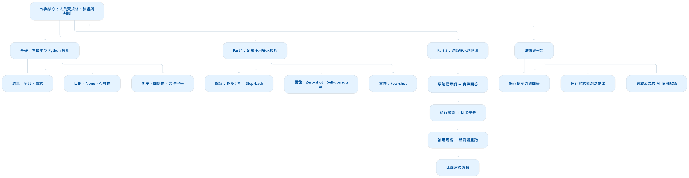

# Assignment 1: Technique Practice and Prompt Diagnosis（技術練習與快速診斷）
## 教學資源：
截止日期：第 8 週結束前－11 月 1 日星期日，當天結束前（23:59）。 權重： 10%。
- 作業說明：[［Assignment1_Technique Practice and Prompt Diagnosis.pdf］](https://github.com/414551016/Computer-Architecture/blob/main/Assignment1/Assignment1_Technique%20Practice%20and%20Prompt%20Diagnosis.pdf) | [{Assignment 1: Technique Practice and Prompt Diagnosis}](https://csic30216-fall26.denniswang.net/assignments/a1/)
- 作業教材：[［csic30216-fall26-assignment1.zip］](https://github.com/414551016/Computer-Architecture/blob/main/Assignment1/csic30216-fall26-assignment1.zip) | [｛csic30216-fall26-assignment1.zip｝](https://e3p.nycu.edu.tw/pluginfile.php/438658/mod_folder/content/0/csic30216-fall26-assignment1.zip?forcedownload=1)
- Prompt：作業說明
  - 請說明本次作業內容、重點及目標為何？ https://csic30216-fall26.denniswang.net/assignments/a1/
  - 我是初學者，我該如何完成作業規定內容，請詳細說明作業步驟為何及學習知識地圖？
  - 好的我的姓名：劉順松 | 學號：414551016，請操作我的電腦先幫我完成本次作業規定任務及目標，之後我再上傳到E3。

這次作業的核心是：練習清楚地指揮 AI 完成軟體工作，並用實際執行結果，診斷提示詞哪裡出了問題、如何改善。 老師評量的是你使用 AI 的方法、判斷與證據，而不只是最後的程式能不能跑。

## 請說明本次作業內容、重點及目標為何？
### 一、作業基本資訊
這份作業要求使用 AI，也要求實際執行提示詞、仔細閱讀回答，並記錄 AI 的使用情形。
| 項目 | 要求 |
|---|---|
| 名稱 | Assignment 1：技巧練習與提示詞診斷 |
| 性質 | 個人作業 |
| 截止時間 | **2026 年 11 月 1 日（日）23:59** |
| 占學期成績 | **10%** |
| 作業配分 | Part 1：50 分；Part 2：50 分 |
| 繳交格式 | 兩部分與 AI 使用紀錄整合為**一份 Markdown 檔** |
| 檔名 | `assignment_1_studentid_name.md`，替換為自己的學號與姓名 |
| 範本與材料 | 從 [E3 作業資料夾](https://e3p.nycu.edu.tw/mod/folder/view.php?id=246973)取得，保留範本標題並填入自己的內容 |

### 二、Part 1：用五種提示技巧完成三項工作（50 分）
三項工作共用一個 Python 待辦事項模組 task_manager.py，分別練習除錯、開發功能與撰寫文件。
| 任務 | 要做什麼 | 指定技巧 | 分數 |
|---|---|---|---:|
| Task 1：除錯 | 修復 `get_overdue_tasks` 在任務沒有截止日時發生的錯誤 | Chain-of-Thought、Step-back | 20 |
| Task 2：開發 | 實作 `sort_tasks_by_priority`，依優先級與截止日排序 | Zero-shot、Self-correction | 20 |
| Task 3：文件 | 替 `calculate_completion_rate` 撰寫函式說明 `docstring` | Few-shot | 10 |

五種技巧要呈現的差異如下：
| 技巧 | 白話說明 | 本作業明確要求 |
|---|---|---|
| **Chain-of-Thought**：逐步推理 | 引導 AI 逐步分析問題 | 提示詞要求先逐步分析或追蹤，再回答 |
| **Step-back**：退一步思考 | 先找出一般原則，再處理眼前案例 | 先說明原則，再套用到錯誤 |
| **Zero-shot**：零樣本 | 不給範例，直接提供清楚規格 | 沒有範例，也沒有推理引導框架 |
| **Self-correction**：自我修正 | 先產生答案，再具體批評，最後修改 | 保留「產生 → 具體批評 → 修訂」三輪 |
| **Few-shot**：少樣本 | 提供範例，讓 AI 仿照格式 | 必須使用 `add_task` 與 `mark_complete` 的兩份 docstring 作為範例 |

其中，排序功能的規格是：
- 優先級高的任務排前面。
- 同一優先級內，截止日較早的排前面。
- 同一優先級內，沒有截止日的排最後。
- 回傳一份新的清單。

每種技巧都要繳交：提示詞原文、完整且未修改的 AI 回答，以及 2～3 句反思。 反思要指出這項技巧對「這一次的結果」增加了什麼，或沒有增加什麼；不必硬說每種技巧都有幫助。

### 三、Part 2：診斷並改寫三個有缺漏的提示詞（50 分）
老師提供三個模擬隊友寫的提示詞，你要觀察 AI 如何理解，再找出提示詞缺漏造成的問題。
| 題目 | 要求的功能 | 要注意的規格缺口 |
|---|---|---|
| Prompt 1 | `add_subtask`：加入子任務 | 原提示詞沒有提供團隊的 `CONVENTIONS.md` 規範 |
| Prompt 2 | `format_task_line`：產生一行任務顯示文字 | 要求使用 `utils.py` 的日期工具，卻沒有提供工具內容 |
| Prompt 3 | `get_urgent_tasks`：取得並排序緊急任務 | 沒有清楚定義「緊急」與「最緊急優先」 |

上表是題目設計中的缺口，你的最終診斷仍必須以自己實際得到的回答與測試結果為準，不能預先認定 AI 一定犯了某種錯誤。

每題的操作順序非常重要
1. 執行原始提示詞：開新對話，先貼完整的 task_manager.py，再貼原提示詞。這次不要提供 CONVENTIONS.md、utils.py 或作者真正意圖；題目要求第一次執行後才閱讀前兩個檔案。
2. 檢查程式：把 AI 產生的程式放入 my_solutions.py，執行 python check_my_work.py，保存程式與檢查輸出。
3. 診斷與改寫：指出資訊缺漏如何導致具體結果，再補上必要規格。
4. 重新執行：另開新對話執行改寫後的提示詞，重新檢查並保存結果。

每題繳交五項內容：
- 失敗模式：具體錯在哪裡，不能只說「提示詞很模糊」。
- 發生機制：運用第 1～7 週的課程概念，解釋缺漏如何導致結果。
- 改寫後的提示詞：真正補足資訊，而不只是加上「請小心」。
- 前後證據：原始版與改寫版的完整程式、檢查輸出。
- 個人經驗連結：一句話描述自己遇過的類似情況。

另有兩個容易漏掉的規定：
- 如果 AI 先提問，記錄這個結果，再回覆 “Please proceed using your best assumptions”，取得程式後測試。
- 如果原始程式全部通過，應如實記錄，並在另外兩個新對話重跑原提示詞，觀察假設是否一致；之後仍要改寫，讓結果不再依賴 AI 猜對規格。

### 四、評分重點：方法、分析與證據
| 部分 | 評分方式 |
|---|---|
| Part 1，每項技巧 10 分 | 技巧使用正確 4 分、完整回答 2 分、具體反思 4 分 |
| Part 2，每題 15 分 | 失敗模式 3 分、機制解釋 4 分、改寫 3 分、證據 4 分、個人經驗 1 分 |
| Part 2，另外 5 分 | 整體證據完整且誠實，診斷與實際輸出一致 |

檢查程式通過，不等於作業就能拿滿分。 網頁明確說明，檢查器協助確認功能，分數則來自提示詞、AI 回答、反思與診斷。原始版本出現 FAIL 是可供分析的證據；沒有失敗也要誠實報告。[評分規準與操作要求](#教學資源)

### 五、這次作業希望你學會什麼？
依照作業的課程定位，主要目標有三個：
1. 把意圖轉成可執行的規格。 例如「幫我排序」還不夠，必須說明排序順序、缺少日期的處理，以及是否能修改原資料。
2. 判斷 AI 的回答是否符合需求。 透過實際測試確認，而不是只看回答是否流暢、程式是否看起來合理。
3. 根據證據修正工作方式。 能解釋「提示詞少了什麼 → AI 做了什麼假設 → 造成什麼結果 → 如何補足」。

我的實作建議是：先取得範本並建立紀錄，再開始跑提示詞。尤其 Part 2 要先完成規定的原始實驗，避免提前提供答案所需資訊，讓前後比較失去意義。

## 我是初學者，我該如何完成作業規定內容，請詳細說明作業步驟為何及學習知識地圖？
你可以把這份作業當成一次小型的「指揮 AI 寫程式、驗證結果、改善指令」練習。你不需要一開始就很會寫 Python，但必須逐漸做到三件事：**看懂需求**、**實際測試**、**用自己的話解釋結果**。
### 1．先理解整份作業的知識地圖

  

學習順序建議是：Python 最小基礎 → 看懂模組 → 五種提示技巧 → 測試與診斷 → 整理報告。
你不需要先學完全部 Python，也不需要訓練模型、架設大型系統或製作網站。

### 2．先學會這些最小必要知識
| 概念 | 白話意思 | 在本作業中的用途 |
|---|---|---|
| Prompt，提示詞 | 你交給 AI 的工作指令 | 指定要寫什麼、遵守什麼規則 |
| Context，上下文 | AI 這次能看到的背景資料 | 程式碼、規範、工具函式、範例 |
| Specification，規格 | 判斷結果對不對的明確條件 | 如何排序、哪些任務算緊急 |
| Function，函式 | 接收資料、執行工作、回傳結果的一段程式 | `get_overdue_tasks(...)` |
| List，清單 | 多筆資料的集合 | 所有待辦事項 |
| Dictionary，字典 | 使用欄位名稱保存資料 | 任務的標題、日期、優先級 |
| `None` | 沒有提供值 | 任務沒有截止日 |
| `True`／`False` | 是／否 | 任務是否完成 |
| `return` | 把結果交回呼叫者 | 回傳排序後的清單 |
| Docstring，文件字串 | 放在函式內的用途與參數說明 | Task 3 的產出 |
| Checker，檢查程式 | 自動比較程式行為是否符合要求 | `check_my_work.py` |
| Failure mode，失敗模式 | 具體是哪一種錯誤 | 遺漏條件、錯誤排序、使用不存在的工具 |

