# Assignment 1：從實驗結果學會提示詞診斷

姓名：劉順松｜學號：414551016

## 目前完成狀態

實際提示實驗、程式、官方檢查與報告整理已完成。官方整合結果為 **33 passed、0 failed、0 warnings、0 not started yet**，另有 **8 項補充測試通過**。這不是成績保證，也不代表你已閱讀或學會內容。正式 Markdown 的三個 **Personal connection** 欄位，已依你確認經歷過的情況協助撰寫；請核對措辭並閱讀確認分析，E3 尚未上傳。

## 檔案怎麼看

| 檔案／資料夾 | 用途 |
|---|---|
| `assignment_1_414551016_劉順松.md` | 依老師範本製作的主報告，包含完整提示、回答、反思、診斷、前後測試與 AI 使用紀錄。核對個人經驗與分析後再上傳。 |
| `completed/task_manager.py` | 修正逾期任務錯誤，並加上完成率函式的文件。 |
| `completed/my_solutions.py` | 排序函式及 Part 2 三題修正版。 |
| `completed/checker_stdout.txt` | 官方 33 項檢查結果。 |
| `completed/additional_tests.txt` | 額外 8 項測試結果。 |
| `evidence/` | 原始／改寫提示與完整回答、獨立測試紀錄、對話連結及完整性指紋。 |
| `materials/` | 老師原始檔案，保留供核對。 |

## 知識地圖

```mermaid
flowchart TD
  A[工程師對結果負責] --> B[說清楚需求]
  A --> C[觀察 AI 回答]
  A --> D[實際驗證]
  B --> B1[Context：規範、工具、資料結構]
  B --> B2[Task：明確工作與選取條件]
  B --> B3[Constraints：不修改輸入、回傳型別]
  C --> C1[逐步分析與 Step-back：找出錯誤原因]
  C --> C2[Zero-shot 與 Self-correction：生成與檢查]
  C --> C3[Few-shot：示範文件格式]
  D --> D1[官方檢查器]
  D --> D2[補充測試與證據比對]
  D1 --> E[根據結果診斷並改寫]
  D2 --> E
```



## 建議閱讀順序：六個小步驟

### 1. 先懂任務資料

每個 task 是一個字典，包含 `title`、`due_date`、`priority`、`completed`。多個 task 放在 `tasks` 清單。`None` 表示沒有日期；`False` 表示尚未完成。

**確認自己懂了：**「高優先、沒有截止日、尚未完成」應是 `priority='high'`、`due_date=None`、`completed=False`。

### 2. 理解除錯

原本直接比較 `None < 日期` 會出錯。修正版先檢查日期不是 `None`，Python 才會繼續比較早晚；這叫 short-circuit evaluation（短路求值）。

逐步分析回答追蹤了錯誤發生位置；Step-back 回答先解釋一般原則。兩者最後使用相同判斷條件，因此不能宣稱其中一種本次測試更正確。

**確認自己懂了：**今天到期不算逾期，因為判斷使用 `< today`，不是 `<= today`。

### 3. 理解排序與自我修正

排序先比較優先級，再比較該優先級內日期。`sorted` 回傳新清單；原清單順序不變。`(0, 日期)` 表示有日期，`(1, 0)` 表示沒有日期；第一個數字已能把沒有日期排後面。

初稿本來就正確，批評回合沒有憑空找錯，修訂主要簡化多餘處理。AI 說自己檢視過程式，不等於它真的執行了測試；本機測試是另外執行的證據。

**確認自己懂了：**高優先但沒有日期，仍排在低優先的任務前面。

### 4. 理解文件與範例

Few-shot 使用 `add_task` 與 `mark_complete` 的 docstring 示範格式。產出正確說明完成數除以總數，空清單回傳 `0.0`。

**確認自己懂了：**四件完成一件回傳 `0.25`，不是數字 `25`，也不是字串 `25%`。

### 5. 對照三題失敗原因

| 題目 | 原始結果 | 補了什麼資訊 | 改寫後 |
|---|---|---|---|
| 子任務 | 布林回傳、缺欄位、沒依規範拋錯 | 明確列出團隊的五項規範 | 該題 6 項通過 |
| 日期文字 | 猜測 `format_date`，導致匯入失敗 | 提供真正 `due_label(due, today)` 及使用方式 | 該題 4 項通過 |
| 緊急任務 | 只選今天或以前到期 | 定義未完成、3 天邊界、高優先例外、排序與不可修改輸入 | 該題 9 項通過 |

第一題官方檢查器對「大小寫與空白」只看有無例外，因此原始版回傳 `False` 竟被判為 PASS。補充測試直接檢查「子任務到底有沒有被新增」，確認原始版實際失敗；最終版則真的新增成功。這是本作業很重要的工程判斷練習：看懂測試驗證了什麼，不能只看綠色結果。

**確認自己懂了：**第二題無法匯入時，不能說測試已檢查過它的顯示文字；程式根本還沒執行到那裡。

### 6. 核對三句個人經驗

主報告搜尋 `Personal connection`。三句已替換為你指定的最後具體版本（回傳格式、日期工具與作業排序）；請核對是否符合實際情況，必要時改成你自己的說法。

再閱讀五段反思與三段診斷：哪些句子你不理解，就先弄懂再確認。確認完成後移除主報告頂端的「仍待本人確認」狀態文字，並在 AI 使用紀錄保留真實協助範圍。

## 如何在自己的電腦重跑

在 PowerShell 執行：

```powershell
Set-Location -LiteralPath 'C:\Users\LSS\Documents\1151\1151_535513-計算機架構\Assignment1\completed'
python check_my_work.py
python test_additional.py
```

第一個指令預期最後顯示：

```text
33 passed, 0 failed, 0 warnings, 0 not started yet
```

第二個指令預期顯示 `Ran 8 tests` 與 `OK`。歷史原始實驗資料夾故意保留失敗，不要為了讓它變綠而修改它們。

## 上傳前

1. 確認主報告姓名與學號正確。
2. 核對三句個人經驗並閱讀確認分析。
3. 保留完整回答、原始失敗紀錄與 AI 使用紀錄。
4. 依 E3 作業頁面上傳主 Markdown，確認檔名正確並完成最終送出。
5. 再查看繳交狀態；本機檔案完成不等於已繳交。
