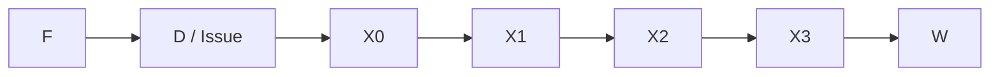

<!-- 可編輯版本：文字與表格直接取自 create_report.py；修改此檔不會自動更新 PDF。分頁標記對應原 PDF。 -->

# Lab 3：雙發射 RISC-V 處理器

姓名：劉順松 | 學號：414551016 | 設計、優化與驗證報告 | 實驗日期：2026-10-13

### 1. Part 1 架構與發射控制

依作業資料路徑完成七階段、雙發射、循序執行處理器。Part 1 僅修改 riscvssc_part1-CoreCtrl.v 與 riscvssc_part1-CoreScoreboard.v；資料路徑、測試程式及記憶體模型維持原始內容。

兩條平行執行管線：A 支援全部指令；B 支援簡單 ALU。兩者均保留至 W。

| 指令 0 / 指令 1 | 管線分派 | 發射條件 |
| --- | --- | --- |
| ALU / ALU | 0 → A；1 → B | 兩者資料就緒、無組內 RAW / WAW |
| ALU / 非 ALU | 0 → B；1 → A | 兩者資料就緒、無組內 RAW / WAW |
| 非 ALU / ALU | 0 → A；1 → B | 基準版較舊分支／跳躍不與較新指令配對 |
| 非 ALU / 非 ALU | 0 → A；1 待發 | 避免爭用唯一的 A 管線 |

### 發射條件與控制一致性

先檢查四個實際使用的來源暫存器，再檢查組內相依。若指令 1 讀取指令 0 的非零目的暫存器，禁止同週期發射；若兩者寫入相同非零目的暫存器，也禁止配對。x0 不建立待寫紀錄。CSR 寫入僅讀取 rs1，CSR 編號不視為 rs2。

只發出指令 0 時，以 consumed0_Dhl 保留原取指組與其 PC；下一次把指令 1 導向 A，使用原組 PC+4。只有整組完成或控制轉移取消較新指令時，才接收下一組。交換 A/B 時同步交換指令、運算元選擇、旁路來源及寫回控制，避免資料與控制錯位。

A/B 各有有效位元與目的暫存器追蹤。X0 因資料記憶體請求未接受而停住時，X1 插入氣泡；X1 等待回應時，X2 插入氣泡。較後方階段繼續排空，避免重複寫回。分支在 X0 確認前進時才重新導向；跳躍於實際發射時重新導向。

### Part 1 的正確性門檻

正常與隨機延遲的指令測試均為 43/43；正常與隨機延遲 benchmark 均為 4/4。合計 94/94 項通過。未把編譯成功或 make check 視為完整處理器驗證。

---

<!-- 原 PDF 第 2 頁 -->

## 2. Scoreboard 與基準效能

Part 1：資料正確性、旁路規則及瓶頸量測

### 追蹤方式與最新生產者

Scoreboard 以 X0、X1、X2、X3、W 五個位置分別保存 A/B 的有效位元、目的暫存器，以及 A 的 load／乘除法類型。此為按管線位置追蹤的相聯式 scoreboard，可同時保留多個寫入同一暫存器的較舊指令。四個來源查詢由最舊掃描至最新，讓最近的較舊生產者覆蓋較遠的匹配；若最新值尚未準備好，必須等待，不能誤取更舊但已完成的值。

| 結果類型 | Part 1 可使用時機 | 旁路選擇 |
| --- | --- | --- |
| 一般 ALU | X0 起 | A：1-5；B：6-10 |
| Load | X1 回應有效且管線可前進時 | 依目前 A 階段選擇 |
| 乘法／除法／餘數 | X3 起 | A 的 X3 或 W |
| 無待寫值或 x0 | 直接讀取暫存器／常數零 | 0 |

追蹤紀錄與實際管線使用相同停頓條件；reset 清除所有有效位元。發射使能只在指令真正進入 X0 時更新。兩管線在 W 各使用一個寫入埠，組內 WAW 檢查防止同週期寫同一目的暫存器。

### 基準週期與瓶頸證據

| Benchmark | 正常週期 | 隨機延遲週期 | 資料等待 / D 空檔 |
| --- | --- | --- | --- |
| vvadd | 1424 | 3928 | 88 / 437 |
| bin-search | 1578 | 3331 | 88 / 470 |
| cmplx-mult | 3826 | 10250 | 716 / 431 |
| masked-filter | 8809 | 24926 | 763 / 3089 |

週期數取自未修改的 Pattern.v 之 num_cycles，涵蓋程式開始至狀態回報，不另改成只量測核心迴圈。正常記憶體模型下，X0 因記憶體背壓造成的停頓計數為 0；資料相依與控制轉移造成的空檔較突出。複數乘法有 716 個來源等待週期，遮罩濾波有 3,089 個 D 無有效指令的觀察週期。

### 剖析方法

以提交目錄外的唯讀模擬監測模組觀察 issue、stall、有效位元與 redirect。資料等待計數只在 D 有有效指令且 X0 可接收時累計；D 空檔計數包含啟動、清除與排空。各事件可能重疊，不相加當作總週期。正式效能數字始終採 Pattern.v 輸出。

---

<!-- 原 PDF 第 3 頁 -->

## 3. Part 2 優化與結果

提早解析分支，並利用既有乘法結果的暫存旁路

### 優化 A：D 階段分支判斷與安全配對

使用現有四個讀取埠及旁路網路，在 D 比較分支運算元，判斷成立後立即使用 D 的分支目標。分支仍通過 X0、X1、X2、X3、W 的有效位元管線；X0 不再重複重新導向。較舊分支不成立時，可與獨立的較新 ALU 配對；成立時取消該 ALU 的 B 有效位元與 scoreboard 寫入。較新分支與較舊 ALU 配對時，保留較舊 ALU 的結果。

### 優化 B：已暫存乘法結果的 X1／X2 旁路

提供的乘除法單元於 X1 的 result1_reg 已保存乘法結果，並經 result2_reg、result3_reg 傳遞。新增兩個低 32 位輸出接點，供 X1／X2 的乘法結果旁路；以同步前進的 fastmul 位元選擇。未增加乘法器，未移除任何原始暫存階段，原 X3 輸出及 W 寫回時機不變。除法與餘數仍等到 X3；load 規則維持不變。

### 公開 benchmark：全部符合 Level 2

| Benchmark | Part 1 | Part 2 | 週期減少 | L2 上限 |
| --- | --- | --- | --- | --- |
| vvadd | 1424 | 1191 | 16.36% | 1200 |
| bin-search | 1578 | 1213 | 23.13% | 1300 |
| cmplx-mult | 3826 | 3304 | 13.64% | 3500 |
| masked-filter | 8809 | 6998 | 20.56% | 7500 |

### 優化貢獻與剩餘瓶頸

| Benchmark | 只做分支優化 | 加入乘法旁路 | 旁路再減少 |
| --- | --- | --- | --- |
| vvadd | 1191 | 1191 | 0 |
| bin-search | 1213 | 1213 | 0 |
| cmplx-mult | 3704 | 3304 | 400 |
| masked-filter | 7164 | 6998 | 166 |

複數乘法的來源等待由 716 降至 316 個週期；遮罩濾波的 D 空檔由 3,089 降至 1,446。分支改善主要降低取指清除損失，乘法旁路降低真正的資料等待。兩條非 ALU 仍爭用 A、組內 RAW 仍需序列化，隨機記憶體延遲仍會限制吞吐量。

資源保持：兩個 ALU、一個乘除法模組、兩個 imem 埠、一個 dmem 埠、四讀兩寫暫存器檔案及原七階段。分支比較邏輯不提供一般運算指令執行能力。尚未做綜合、面積或時序收斂；較長的 D 比較／旁路路徑可能影響實際時脈，因此週期改善不直接等同實體時間改善。

---

<!-- 原 PDF 第 4 頁 -->

## 4. 驗證、重現與限制

工具：Icarus Verilog 12.0 / RISC-V GCC 14.2.0 / GNU Make 4.3 / Ubuntu WSL

| 驗證項目 | Part 1 | Part 2 |
| --- | --- | --- |
| 提供的指令測試：正常延遲 | 43 / 43 | 43 / 43 |
| 提供的指令測試：隨機延遲 | 43 / 43 | 43 / 43 |
| 提供的 benchmark：正常延遲 | 4 / 4 | 4 / 4 |
| 提供的 benchmark：隨機延遲 | 4 / 4 | 4 / 4 |
| 額外定向／隨機程式，三種延遲 | 39 / 39 | 39 / 39 |

### 額外測試內容

Python 獨立計算 12 個固定種子的程式結果，每個包含 300 次隨機選擇的 ALU、乘除法、load/store 與分支操作，再逐一檢查 24 個一般暫存器、x0 及 32 個記憶體字。另加定向程式驗證同組分支取消、第二槽 AUIPC 的 PC、JAL/JALR 連結位址、奇數 JALR 目標對齊、最新寫入優先與連續乘法相依。

兩版本各以 p_max_delay = 0、4、9 執行 13 個程式，合計 78/78 通過。監測器另外檢查未知值寫回、同週期 WAW、B 執行不支援指令及向停住的 X0 發射。額外測試不取代課程測試，也不代表窮盡全部輸入。

### 隨機延遲 benchmark 結果

| Benchmark | Part 1 週期 | Part 2 週期 |
| --- | --- | --- |
| vvadd | 3928 | 3863 |
| bin-search | 3331 | 3064 |
| cmplx-mult | 10250 | 9659 |
| masked-filter | 24926 | 23779 |

### 重現方式與提交內容

解開 414551016-lab3.tar.gz，保留 lab3 根目錄。分別在 tests/build、ubmark/build 執行 ../configure --host=riscv32-unknown-elf、make、../convert，接著在 build 執行 make。對兩個版本分別執行 check-asm、check-asm-rand、run-bmark、run-bmark-rand，目標尾碼為 -riscvssc_part1 或 -riscvssc_part2。Part 2 已包含完整來源，不需再次執行 setup.sh。

### 限制與責任界線

本報告僅陳述本機測試及公開門檻；隱藏 benchmark 與 Level 3 排名須由課程端評定。原始測試程式、測試平台與編譯最佳化設定未為效能分數修改。可再研究更有效的指令佇列與分支預測，但須維持資源限制並重新驗證。

工具協助：使用 Codex 協助程式編修、模擬整理與報告草稿製作；依 Lab0 規範，提交者仍須檢查內容並能說明設計。參考資料：課程 lab3.pdf（2026-10-04 修訂）及本次提供的 lab3.tar.gz。
