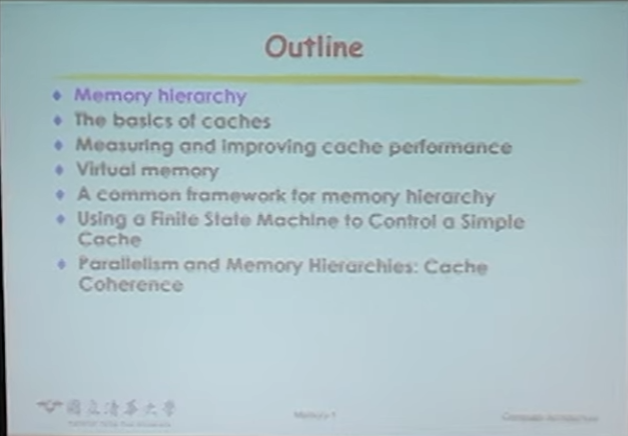
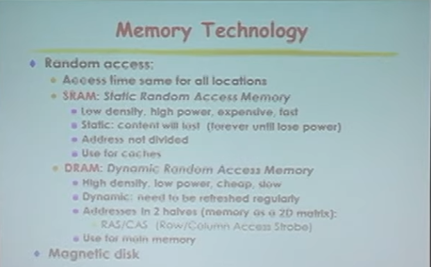

# 第22AR講 Memory

### 教學資源：
- [11010黃婷婷教授計算機結構_第22AR講 Memory(48:11)](https://www.youtube.com/watch?v=fs6n2Yjt3X4&list=PLpXfHEl2fzl47WOaypHoOWxBIhG42_Vlq&index=31)
- Prompt：
  - 請將本教學內容英/中翻譯比對 請說明本slide教學重點內容及你的看法，最後以250字內總結

  

- 教學內容英/中翻譯比對：
   關於記憶體階層（Memory Hierarchy）單元的大綱（Outline），內容主要對應經典教科書《Computer Organization and Design》（David A. Patterson 與 John L. Hennessy 著）的第五章結構。

  投影片中列出的七個核心主題：
  - Memory hierarchy（記憶體階層）：介紹區域性原理（Principle of Locality，包含時間與空間區域性），以及如何利用不同速度、容量與成本的儲存媒體（暫存器、快取、主記憶體、磁碟）打造兼顧大容量與高速度的記憶體系統。
  - The basics of caches（快取記憶體基礎）：探討快取的基本運作機制，包含區塊放置（Direct Mapped、Set Associative、Fully Associative）、位址標籤（Tag）比對、讀取命中/失誤（Hit/Miss）處理，以及寫入策略（Write-Through 與 Write-Back）。
  - Measuring and improving cache performance（量測與改進快取效能）：學習如何計算平均記憶體存取時間（AMAT）與 CPU 停頓時間，並透過調整區塊大小、提高關聯度（Associativity）及導入多層級快取（Multi-level Caches）來降低失誤率與失誤代價（Miss Penalty）。
  - Virtual memory（虛擬記憶體）：說明作業系統與硬體如何協同管理主記憶體與磁碟之間的資料交換，涵蓋分頁（Paging）、分頁表（Page Table）、轉譯後備緩衝區（TLB）以及記憶體保護機制。
  - A common framework for memory hierarchy（記憶體階層的通用框架）：將快取與虛擬記憶體歸納為統一的設計框架，探討「區塊放置、尋找、替換策略（如 LRU）與寫入策略」這四個核心問題，並介紹快取失誤的「3Cs 模型」（Compulsory、Capacity、Conflict）。
  - Using a Finite State Machine to Control a Simple Cache（使用有限狀態機控制簡易快取）：從硬體實作角度出發，示範如何透過有限狀態機（FSM）設計快取控制器（Cache Controller），處理讀寫請求與主記憶體之間的資料傳輸狀態轉換。
  - Parallelism and Memory Hierarchies: Cache Coherence（平行化與記憶體階層：快取一致性）：探討多核心處理器架構下，各核心擁有獨立快取時可能發生的資料不一致問題，以及硬體如何透過偵聽協定（Snooping Protocols，如 Write Invalidate）來維持快取一致性。

## Memory Technology

  

教學內容英/中翻譯比對
 Memory Technology | 記憶體技術
- Random access: | 隨機存取：
  - Access time same for all locations | 所有記憶體位置的存取時間皆相同
  - SRAM: Static Random Access Memory | SRAM：靜態隨機存取記憶體
    - Low density, high power, expensive, fast | 密度低、功耗高、價格昂貴、速度快
    - Address not divided | 位址不分割（一次輸入完整位址）
    - Use for caches | 用於快取記憶體（Cache）
  - DRAM: Dynamic Random Access Memory | DRAM：動態隨機存取記憶體
    - High density, low power, cheap, slow | 密度高、功耗低、價格便宜、速度慢
    - Dynamic: need to be refreshed regularly | 動態特性：需要定期刷新（Refresh）以維持資料
    - Addresses in 2 halves (memory as a 2D matrix): 位址分為兩半（將記憶體視為二維矩陣）：
      - RAS/CAS (Row/Column Access Strobe) | 列位址選通 / 行位址選通（RAS/CAS）
  - Use for main memory | 用於主記憶體（Main Memory）
- Magnetic disk | 磁碟（傳統硬碟）

教學重點內容：
 本頁投影片在建立 記憶體階層（Memory Hierarchy） 的硬體基礎，核心重點如下：
- 隨機存取（Random Access）定義：點出 SRAM 與 DRAM 共同的核心特性。無論資料存放在哪個實體位置，存取延遲（Access Time）都相同（這也是它們與序列存取裝置如磁帶、或受機械尋道影響的磁碟最大的不同）。
- SRAM 與 DRAM 的特性對比：
  - SRAM（靜態）：利用正反器（Flip-Flop）結構儲存，只要供電資料就不會遺失，速度快但電晶體數量多導致密度低、功耗與成本高，因此專門用來打造容量小但極需速度的 快取（Cache）。
  - DRAM（動態）：利用電容儲存電荷，結構極簡因此密度高、成本低，但電容會漏電必須定期刷新（Refresh）；為了減少晶片接腳數，將記憶體排成二維陣列並透過 RAS/CAS 分兩次傳送列與行位址，適合當作大容量的 主記憶體（Main Memory）。
- 非隨機存取對照（Magnetic disk）：在最下方列出磁碟，作為接下來探討「區塊存取、機械延遲與大容量非揮發性儲存」的銜接伏筆。

我的看法與補充
- 完美的「工程權衡（Trade-off）」教材：這張投影片非常精準地解釋了為什麼現代電腦不全部使用最快的 SRAM，也不全部使用最便宜的 DRAM——因為沒有任何單一技術能同時滿足「極速、大容量、低成本」，這正是推動記憶體階層架構誕生的根本原因。
- 從硬體物理連貫到架構設計：投影片中特別點出 DRAM 的 RAS/CAS 位址分割，這在電腦架構中非常重要。它直接解釋了為什麼 DRAM 連續讀取同一列（Row Buffer Hit）會比跨列讀取快上許多，進而影響到記憶體控制器（Memory Controller）的排程演算法與程式的空間局部性（Spatial Locality）優化。

內容總結：
 本投影片介紹電腦系統中的核心記憶體技術，重點對比兩種隨機存取記憶體（存取時間不隨位置改變）： SRAM（靜態）無需刷新即可維持資料，具備極高速度但密度低、成本與功耗高，適合用於快取（Cache）； DRAM（動態）結構簡單、密度高且便宜，但需定期刷新，並透過 RAS/CAS 將位址分為兩半以二維矩陣存取，適合做為主記憶體。 最後帶出磁碟做為大容量儲存的銜接。整體清楚展現了速度、容量與成本間的硬體權衡，為記憶體階層架構奠定基礎。

