# Week 3 (2026-10-15)課堂逐字稿
## 教學資源：
- [SD3.pdf](./Lecture/SD3.pdf)
- Prompt：
  - 請將本教學內容英/中翻譯比對
  - 請說明本教學重點內容及你的看法，最後以250字內總結
## 知識點：
- [亂序執行（Out-Of-Order, OOO Execution）](#亂序執行out-of-order-ooo-execution)
- [亂序執行處理器（Out-of-Order Processor, 簡稱 OOO Processor）](#亂序執行處理器out-of-order-processor-簡稱-ooo-processor)
### 亂序執行（Out-Of-Order, OOO Execution）
亂序執行（Out-Of-Order, OOO Execution） 是一種現代 CPU 用來提高指令級平行度（Instruction-Level Parallelism, ILP）與處理器效能的動態排程機制。
 在傳統的按序執行（In-Order, IO）處理器中，指令必須完全按照程式碼寫好的順序依次進入管線執行。如果前方有一條執行時間較長的指令（例如乘除法或讀取記憶體 Cache Miss），後方即使有已經準備好且完全不相干的指令，也必須被強制停頓（Stall）等待。
 **亂序執行**的核心概念是：只要指令的輸入資料已就緒（Data Ready）且所需的計算單元空閒，處理器就可以打破原本程式的順序，優先執行該指令。
- 亂序執行處理器的四大關鍵階段：
   現代典型的亂序處理器（如 $IO_2I$ / $IO_2I$ 架構）將指令週期拆分為以下四個主要階段：
  - Frontend（前段取指與解碼 - 按序 In-Order）： 按照程式碼的原始順序（Program Order）將指令取出並解碼。
  - Issue（發射與排程 - 亂序 Out-of-Order）： 指令進入發射佇列（Issue Queue / Reservation Station）等待。一旦資料相依性解除且運算單元就緒，即可亂序發射執行。
  - Writeback（執行與寫回 - 亂序 Out-of-Order）： 不同運算費時不同（例如 ALU 費時 1 週期，乘法費時 4 週期，記憶體存取費時多週期），指令會以亂序的方式完成並將結果寫回內部緩衝區。
  - Commit（提交 - 按序 In-Order）： 為了維持程式邏輯的正確性與精確例外（Precise Exceptions），最後必須將亂序執行的結果重新拉回原本的順序按序提交，正式更新暫存器與記憶體狀態。
- 實現亂序執行的核心硬體元件：
  - Issue Queue / Reservation Station（發射佇列 / 保留站）：暫存解碼後的指令，動態監控資料是否就緒，實現亂序發射。
  - Reorder Buffer, ROB（重排序緩衝區）：追蹤所有在途（In-Flight）指令，負責將亂序完成的結果重新排序，確保指令依序提交（In-Order Commit）。
  - Store Buffer（儲存緩衝區）：暫存記憶體寫入操作，確保 Store 指令在確定提交前不會污染 Cache 或主記憶體。
  - Scoreboard（記分板）：用於監控資料相依性與暫存器狀態，防止資料危害（Data Hazards）。
- 主要優勢：
  - 擺脫管道阻塞（Head-of-Line Blocking）：當某一條長延遲指令（如讀取記憶體）卡住時，後續無相依關係的指令可以繼續執行。
  - 極大化硬體利用率：利用多條獨立的相依鏈（Dependency Chains）填滿 CPU 内的多個執行單元（ALU, MUL, MEM 等）。
  - 兼顧效能與正確性：採用 $IO_2I$ 架構（Execute OOO, Commit In-Order），既能達到最高效能，又能完美維護精確例外與程式正確語意。

### 亂序執行處理器（Out-of-Order Processor, 簡稱 OOO Processor）
亂序執行處理器（Out-of-Order Processor, 簡稱 OOO Processor） 是一種現代高效能 CPU 採用的微架構設計，其核心宗旨是透過動態排程（Dynamic Scheduling） 來提高指令級平行度（Instruction-Level Parallelism, ILP）與處理器吞吐量。
- 一、為什麼需要亂序執行？（動機）
   在傳統的按序執行（In-Order, IO）處理器中，指令必須嚴格按照程式碼寫好的順序進入管線執行。若前方有一條執行時間較長的指令（如多週期乘法、記憶體存取或發生 Cache Miss）陷入等待，後方即使有已經準備好資料且完全獨立的指令，也會被強制卡住（即 Head-of-Line Blocking / 管道阻塞）。
   **亂序執行的核心思想：**
   「資料就緒即執行」只要指令所需的輸入運算元已經準備好（Data Ready），且對應的硬體執行單元空閒，處理器就可以跳過前方被阻塞的指令，優先發射並執行該指令。
- 二、亂序執行處理器的四大階段（以現代 $IO_2I$ 架構為例）
   現代標準的亂序處理器（如 Intel Core、AMD Zen、Apple M 系列與 RISC-V 高效能核心）將指令週期拆分為四個主要階段：
  - Frontend（前段 / 按序 In-Order）：
    - 按照程式碼的原始順序（Program Order）進行取指（Fetch）與解碼（Decode）。
  - Issue（發射與排程 / 亂序 Out-of-Order）：
    - 解碼後的指令進入發射佇列（Issue Queue / 保留站 Reservation Station）等待。一旦資料相依性解除（運算元就緒）且執行單元空閒，即可亂序發射到相應的運算管道（如 ALU、MUL、MEM）。
  - Writeback（執行與寫回 / 亂序 Out-of-Order）：
    - 由於不同管道的執行延遲不同（如 ALU 需 1 週期、MEM 需 2 週期、MUL 需 4 週期），指令會以亂序的方式完成，並將結果寫回內部緩衝區。
  - Commit（提交 / 按序 In-Order）：
    - 為了維持程式邏輯的正確性與精確例外（Precise Exceptions），亂序執行的結果必須在 Reorder Buffer (ROB) 中排隊，重新拉回原本的順序按序提交，正式更新架構暫存器與記憶體狀態。
- 三、實現亂序執行的核心硬體組件：
   亂序處理器之所以能做到「亂而不雜」，依賴以下關鍵硬體分工：
  - Scoreboard（計分板）：用於監控與記錄暫存器狀態、運算單元佔用情況以及資料相依性（Data Hazards）。
  - Issue Queue / Reservation Station（發射佇列 / 保留站）：暫存解碼後的指令，動態監控資料暫存器與運算單元是否就緒，實現數據驅動（Data-Driven）的亂序發射。
  - Reorder Buffer, ROB（重排序緩衝區）：追蹤所有在途（In-Flight）指令，將亂序寫回（OOO WB）的結果依原本程式順序暫存，確保指令能按序提交（In-Order Commit），這是維護精確例外的靈魂元件。
  - Store Buffer（儲存緩衝區）：暫存寫入記憶體的操作，確保 Store 指令在確定 Commit 之前不會誤寫入 L1 Cache，避免破壞記憶體狀態。
- 四、主要優勢：
  - 極大化硬體利用率與 ILP：利用多條獨立的資料相依鏈（Dependency Chains），讓多個 execution pipes（ALU, MUL, MEM）同時運作，充份填滿管線。
  - 掩蓋長延遲（Latency Hiding）：當存取記憶體或複雜運算卡住時，後續無關的指令能繼續執行，縮短整體程式執行時間。
  - 兼顧效能與精確例外：採用 $IO_2I$ 架構（Execute OOO, Commit In-Order），既獲得亂序發射的高吞吐量，又保有按序提交帶來的精確例外能力與猜測執行復原能力。

## slide：34 Out-of-Order Processors（亂序執行處理器）

  
  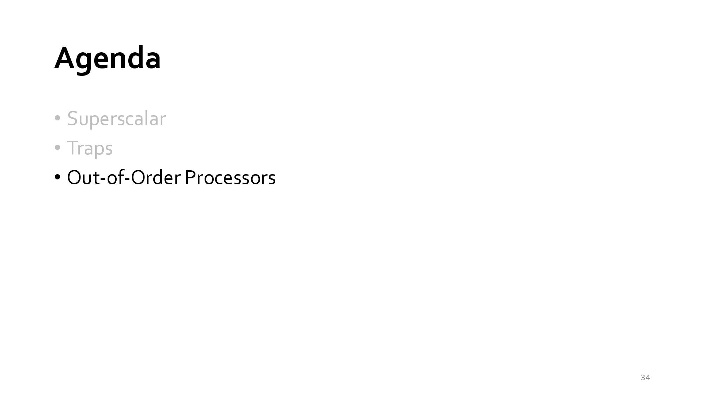

這張投影片為課程章節的 Agenda（課程大綱 / 內容目錄），標示了本單元的三大核心主題：
- 本教學重點內容：
  - Superscalar（超純量架構）：
     探討如何在單一時鐘週期內同時發射（Issue）與執行多條指令（如 2-way 或 4-way Superscalar），以突破 $CPI < 1$ 的限制。
  - Traps（陷阱與例外處理機制）：
     介紹同步例外（Synchronous Exceptions）與異步中斷（Asynchronous Interrupts）的分類、中斷處理程式（Handler）的運作，以及如何在流水線中實現精確例外（Precise Exceptions）。
  - Out-of-Order Processors（亂序執行處理器）：
     本章節即將進入的新主題，探討如何透過動態排程（Dynamic Scheduling）、保留站（Reservation Stations）、重排序緩衝區（Reorder Buffer, ROB）與暫存器重命名（Register Renaming）技術，允許指令不按程式順序（Out-of-Order）執行以解開 Data Hazards，同時依然維持按序提交（In-Order Commit）來保證 Precise Exception。
- 個人看法：
   這張 Agenda 展現了現代高效能 CPU 設計演進的三部曲：
  - 從 Superscalar 到 Out-of-Order 的必然性：
    - 單純的 In-Order Superscalar 雖然能同時發射多條指令，但只要遇到一次 Data Hazard 或 Cache Miss，整條管線就會陷入 Stalling（停頓）。
    - 為了真正發揮 Superscalar 的多發射能力，微架構必須轉向 Out-of-Order Execution（OoO），讓不互相依賴的後續指令「繞過」被阻塞的指令先執行。
  - Traps 是 OoO 架構的最大挑戰：
    - 將 Traps 放在 Superscalar 與 Out-of-Order 之間講授非常合理。在 OoO 處理器中，指令執行的順序已經完全打亂，要如何在發生 Trap 時恢復到「邏輯上精確」的程式狀態（Precise Exception），是 OoO 設計中最核心也最複雜的課題（例如依靠 ROB 來實現 In-Order Commit）。
- 總結：
   本投影片標誌著課程即將從「Traps 與精確例外處理」邁入下一個重頭戲——Out-of-Order Processors（亂序執行處理器）。接下來將深入學習現代高效能 CPU 如何在亂序執行的極致效能與精確例外的正確性之間取得平衡。

## slide：35

  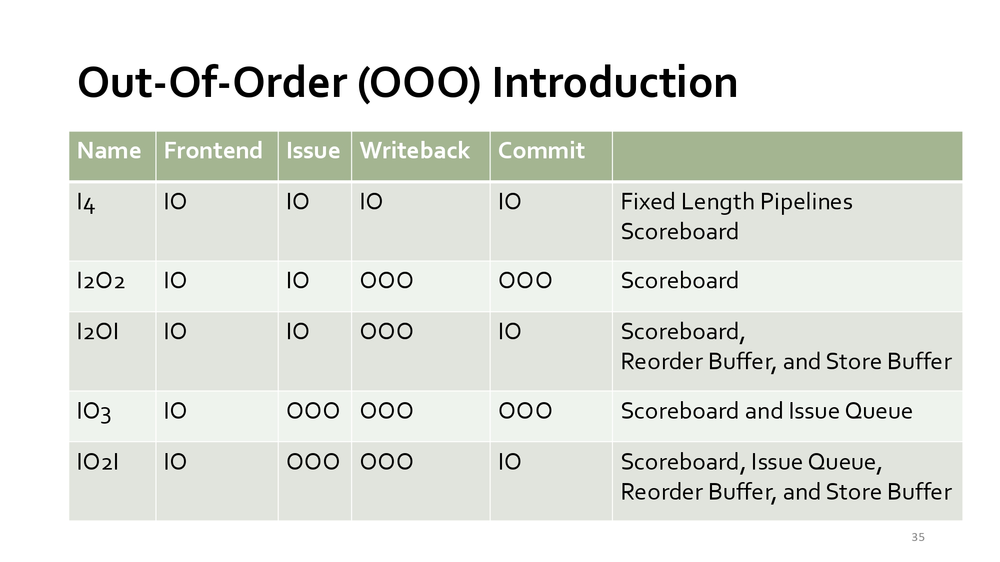

這張投影片為 「Out-Of-Order (OOO) Introduction（亂序執行處理器導論）」，透過一張分類表格整理了微架構在指令發射與執行的不同發展階段，以及各階段所需的硬體控制元件。
- 表格欄位說明：
  - Name（名稱代號）：以 $I$ (In-Order) 與 $O$ (Out-of-Order) 的組合命名各管線階段。
  - Frontend（前段 / 取指與解碼）：皆為 IO (In-Order)，即按程式順序取指與解碼。
  - Issue（發射）：分為按序發射 (IO) 與亂序發射 (OOO)。
  - Writeback（寫回暫存器）：分為按序寫回 (IO) 與亂序寫回 (OOO)。
  - Commit（提交 / 架構狀態更新）：分為按序提交 (IO) 與亂序提交 (OOO)。
- 本教學重點內容：
  - $I_4$ 架構 (In-Order Everything)：
    - 機制：Frontend, Issue, Writeback, Commit 全為 In-Order。
    - 硬體需求：固定長度流水線（Fixed Length Pipelines）與 Scoreboard（計分板機制）。
    - 特性：最基礎的古典流水線，簡單但容易因為 Data Hazard 造成停頓。
  - $I_2 O_2$ 架構 (In-Order Issue / Out-of-Order WB & Commit)：
    - 機制：按序發射，但允許不同執行時間的指令亂序完成（OOO Writeback & Commit）。
    - 硬體需求：Scoreboard。
    - 缺點：無法支援精確例外（Imprecise Exceptions）。
  - $I_2 OI$ 架構 (In-Order Issue & Commit / Out-of-Order WB)：
    - 機制：按序發射（IO Issue），允許執行過程中亂序寫回（OOO Writeback），但最終按序提交（IO Commit）。
    - 硬體需求：Scoreboard、Reorder Buffer (ROB)、Store Buffer。
    - 特性：導入 ROB 解決了 $I_2 O_2$ 的缺陷，成功實現 Precise Exceptions（精確例外）。
  - $IO_3$ 架構 (In-Order Frontend / Out-of-Order Execution & Commit)：
    - 機制：Frontend 按序，但進入 Issue Queue 後允許亂序發射（OOO Issue）與亂序執行/提交。
    - 硬體需求：Scoreboard 與 Issue Queue（發射佇列 / 保留站 Reservation Station）。
  - $IO_2 I$ 架構 (Full Out-of-Order Core with In-Order Commit)：
    - 機制：前端按序，進入 Issue Queue 後亂序發射與執行（OOO Issue & WB），最後在 Commit 階段強制按序提交（IO Commit）。
    - 硬體需求：Scoreboard、Issue Queue、Reorder Buffer (ROB) 與 Store Buffer。
    - 地位：現代所有高效能 CPU（Intel, AMD, Apple, ARM Cortex-A/X）的核心標準架構！
- 個人看法：
   這張表格是計算機結構中極度經典且清楚的架構演進分類表：
  - ROB（Reorder Buffer）的關鍵價值：
    - 觀察表格可以發現，只要 Commit 欄位是 IO（In-Order）（如 $I_2 OI$ 和 $IO_2 I$），硬體需求就必定出現 Reorder Buffer (ROB)。
    - 這印證了前幾張投影片所學：要在亂序發射/執行的極致效能下維護 Precise Exceptions，ROB 就是將「亂序結果」重新拉回「按序提交」的核心安檢閘門。
  - Store Buffer 的必要性：
    - 當 Commit 被要求必須按序（IO）時，記憶體寫入（Store 指令）絕對不能在 OOO 階段就直接寫進 L1 Data Cache，否則無法撤銷。因此必須先暫存在 Store Buffer，等到 Commit Point 確定沒有 Exception 後才正式寫入 Cache。
- 總結：
   本投影片總結了處理器從純按序（ $I_4$ ）邁向現代高效能亂序執行（ $IO_2 I$ ）的演進圖譜：透過 Issue Queue 實現亂序發射以提升效能，並結合 Reorder Buffer (ROB) 與 Store Buffer 實現按序提交（In-Order Commit），完美達成高效能與精確例外的兼顧。

## slide：36

  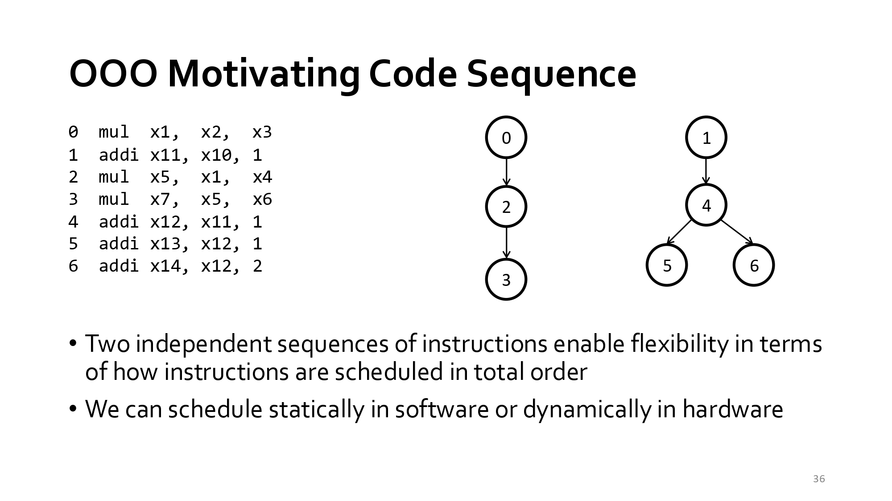

這張投影片主題為 「OOO Motivating Code Sequence（亂序執行的程式碼範例動機）」，透過一組簡單的指令序列與其資料相依圖（Data Dependency Graph），說明亂序執行（Out-of-Order Execution）在排程上的靈活性與優勢。
- 本教學重點內容：
  - 程式碼序列（Code Sequence）與資料相依性：
    - 指令 0：mul x1, x2, x3
    - 指令 1：addi x11, x10, 1
    - 指令 2：mul x5, x1, x4（相依於指令 0 的 x1）
    - 指令 3：mul x7, x5, x6（相依於指令 2 的 x5）
    - 指令 4：addi x12, x11, 1（相依於指令 1 的 x11）
    - 指令 5：addi x13, x12, 1（相依於指令 4 的 x12）
    - 指令 6：addi x14, x12, 2（相依於指令 4 的 x12）
  - 獨立的指令鏈（Two Independent Sequences）：
    - 右方圖表顯示這 7 條指令可拆解為兩條完全獨立、互不影響的相依鏈（Dependency Chains）：
      - 鏈一（乘法鏈）： $0 \rightarrow 2 \rightarrow 3$
      - 鏈二（加法鏈）： $1 \rightarrow 4 \rightarrow (5, 6)$
  - 全序排程的彈性（Flexibility in Total Order Scheduling）：
    - 由於兩條鏈彼此獨立，硬體或編譯器在安排指令執行順序（Total Order）時擁有極高的彈性。
    - 例如：若鏈一的乘法需要較多週期（Latency 長），處理器可以先執行鏈二的加法指令（如在指令 0 執行時同時執行指令 1 與 4），而不需停頓（Stall）等待乘法完成。
  - 靜態與動態排程（Static vs. Dynamic Scheduling）：
    - 靜態排程（Static Scheduling）：在編譯時期由軟體（Compiler）重新排列指令順序。
    - 動態排程（Dynamic Scheduling）：在執行時期由硬體（Hardware / Out-of-Order Core）根據運算單元與資料就緒狀態，動態調整執行順序。
- 個人看法：
   這張圖以極簡的方式揭示了 「指令級平行（Instruction-Level Parallelism, ILP）」 的本質：
  - 打破順序執行的魔咒：
    - 在傳統按序（In-Order）處理器中，如果指令 0 (mul) 因為等待資料或運算時間較長而阻塞，後續的指令 1、4、5 都必須無奈跟著停頓。
    - 但從資料相依圖可以清晰看到，指令 1, 4, 5, 6 跟指令 0, 2, 3 根本沒有半點關係！
  - 為什麼硬體需要動態排程（OOO）？
    - 編譯器靜態排程雖然有幫助，但無法應對「執行時期才確定的停頓」（例如 Cache Miss 或動態 Branch Misprediction）。
    - 透過 OOO 微架構，硬體能即時觀察這張 DAG（有向無環圖），只要運算資源空閒且資料已就緒（Ready），就能「亂序」發射並執行，大幅提升 Pipeline 的利用率！
- 總結：
   本投影片展示了動態亂序執行的核心動機：程式碼中常包含多條獨立的相依鏈，透過動態排程（Dynamic Scheduling），處理器能靈活交錯執行無關的指令，避免傳統按序流水線因單一長延遲指令而陷入停頓，進而極大化指令級平行度（ILP）。

## slide：37

  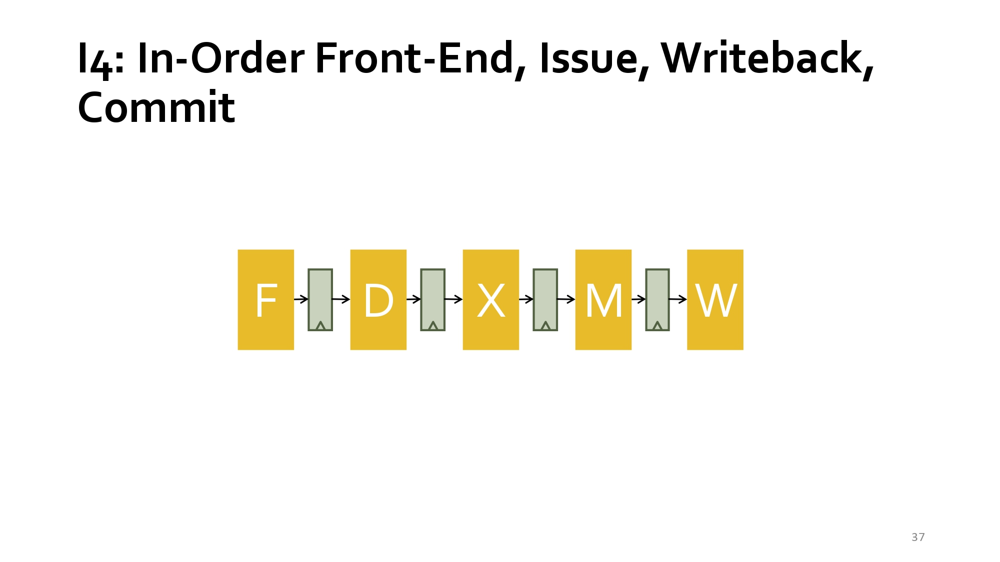

這張投影片主題為 「I4: In-Order Front-End, Issue, Writeback, Commit」，展示了一個經典的 5 階段順序處理管線（In-Order Pipeline）架構。
- 本教學重點內容：
  - 基本 5 階段管線架構（5-Stage Pipeline）：
    - F (Fetch，取指)：從指令記憶體讀取指令。
    - D (Decode / Issue，譯碼 / 發射)：解析指令並讀取暫存器，順序發射至執行階段。
    - X (Execute，執行)：由算術邏輯單元（ALU）進行運算或計算位址。
    - M (Memory，記憶體存取)：讀取或寫入資料記憶體。
    - W (Writeback / Commit，寫回 / 提交)：將結果寫回暫存器檔案，完成指令提交。
  - 「In-Order」（順序）核心特徵：
    - 從前端取指（Front-End）、發射（Issue）、寫回（Writeback）到最後的提交（Commit），指令全過程皆按照程式碼原始順序進行處理。
- 個人看法：
   這張投影片代表了微架構設計中最基礎、最標準的 CPU 基準模型（Baseline Architecture）。
  - 優點：架構簡單、控制邏輯直觀，且因為所有階段均為順序（In-Order），能天然地支援精確中斷（Precise Interrupts）與簡單的流水線暫存器設計。
  - 局限：當發生長延遲操作（如 Memory Miss）或指令間資料相依（Data Hazard）時，整個管線容易發生停頓（Stall）。這也是後續課程探討「亂序執行（Out-of-Order）」與「超純量（Superscalar）」架構的關鍵背景與理由。
- 總結： 本投影片展示經典 5 階段順序管線（F-D-X-M-W），強調指令在前端取指、發射、寫回與提交全程皆按原始順序執行。此架構設計簡單且易於維持精確中斷，但面對資料相依與記憶體延遲時易生停頓。它是學習亂序執行與超純量處理器等進階微架構的最佳基礎標竿。

## slide：38

  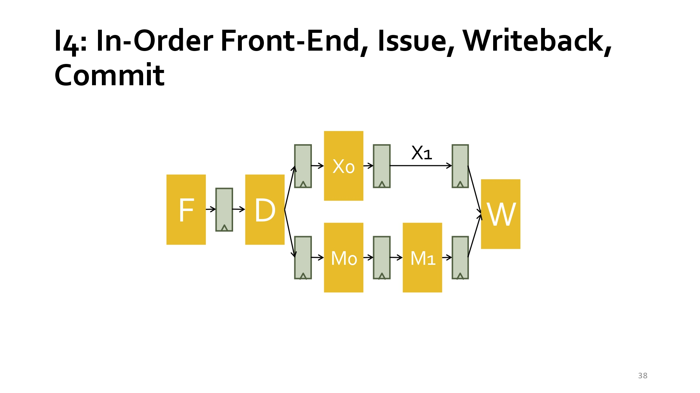

這張投影片展現了包含多條非對稱執行管線（Asymmetric Execution Pipelines）的進階 In-Order 架構。
- 本教學重點內容：
  - 多路/異構執行階段（Multiple Execution Paths）：
    - 前端（F, D）：指令順序進行取指（Fetch）與譯碼/發射（Decode/Issue）。
    - 分支執行管線：
      - ALU/算術路徑 ($X_0 \to X_1$)：處理一般的算術與邏輯運算
      - Memory/記憶體路徑 ($M_0 \to M_1$)：處理 Load/Store 等記憶體存取操作。
    - 後端（W）：兩條平行路徑運算完成後，匯合至 Writeback（寫回）階段進行結果提交。
  - 核心挑戰：結構衝突與結構冒險（Structural Hazards）：
   - 由於不同的執行路徑具備相同的流水線長度（皆為 2 階段），若不同類型的指令同時進入各自路徑，可能面臨同時抵達 W 階段搶奪 Write Port（寫回埠）的衝突。
- 個人看法： 這張圖是從單一流水線走向異構多執行單元（Asymmetric/Multi-pipeline Structure）的核心過渡模型。
  - 優點：允許不同類型的指令（如算術運算與記憶體存取）進行重疊與平行處理，提升了硬體資源利用率。
  - 隱憂與挑戰：雖然執行階段分流，但寫回埠（W Stage）成為集中的瓶頸點。若沒有設計適當的 Arbitration（仲裁）或 Stall（停頓）邏輯，極易產生寫回衝突；此外，不同執行時間也可能引發 WAW 或 RAW 等資料相依（Data Hazards）問題。
- 總結：
   本投影片展示包含算術與記憶體分流的雙路順序管線架構（F-D-$X_0$/$M_0$-$X_1$/$M_1$-W）。重點在於說明指令譯碼後可依類型分派至不同執行路徑以提升平行度。然而，異構路徑最終匯合於同一 Writeback 階段，會衍生寫回埠競爭與資料相依問題，是設計管線仲裁與控制邏輯的關注焦點。

## slide：39

  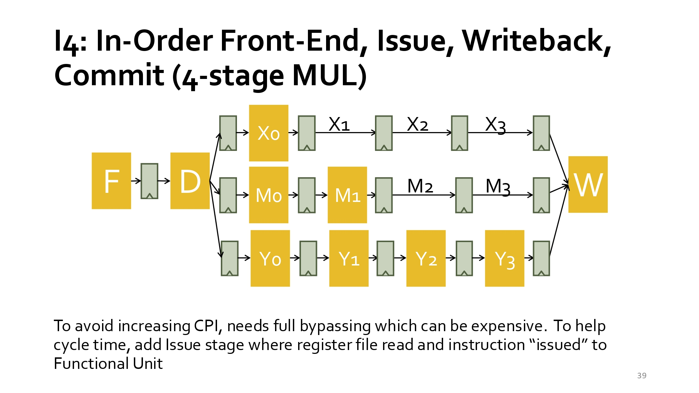

這張投影片介紹的是具備長延遲執行路徑（4-stage MUL）的順序管線架構。
- 本教學重點內容：
  - 非對稱的多階段執行路徑（Asymmetric Multi-Stage Execution）：
    - 取指與發射（F, D）：前級仍維持順序處理。
    - 多路平行執行單元：
      - 一般算術路徑 ($X_0 \to X_1$)：耗時較短（2 階段）。
      - 記憶體路徑 ($M_0 \to M_1 \to M_2 \to M_3$)：4 階段設計。
      - 乘法/複雜運算路徑 ($Y_0 \to Y_1 \to Y_2 \to Y_3$)：4 階段設計（4-stage MUL）。
    - 寫回階段（W）：所有執行單元算完後皆匯入 W 階段寫回暫存器。
  - 效能與硬體開銷的權衡（Trade-off）：
    - 全旁路（Full Bypassing）：為了避免長延遲運算拉高 CPI（降低效能），硬體需要極為複雜且昂貴的全旁路 forwarding 電路。
    - 新增 Issue 階段：為了維持與優化時脈週期時間（Cycle time），將暫存器讀取與指令發射（Issue）至功能單元（Functional Unit）的步驟獨立或優化處理。
- 個人看法： 此架構反映出真實 CPU 處理器在面對「不同運算需要不同週期」時的折衷設計。
  - 優點：允許乘法或長記憶體存取等慢速運算管線化（Pipelined），不至於讓簡單的 ALU 運算被卡住，有助於維持高 throughput。
  - 瓶頸與複雜度：由於執行路徑長度不一（2 階段 vs. 4 階段），若較晚發射的短指令比較早發射的長指令先算完，會產生 WAW 衝突 或 亂序寫回（Out-of-Order Completion） 的問題；且跨長度的 Bypassing 電路會讓晶片面積與功耗大增。
- 總結：
   本投影片展示包含 4 階段乘法器與記憶體路徑的多管道順序 CPU 架構。重點說明長延遲運算單元雖能提高平行度，但需要極昂貴的全旁路電路以避免 CPI 增加，同時需獨立發射階段來確保時脈週期效能，並進一步衍生了結構衝突與寫回順序控制的挑戰。

## slide：40

  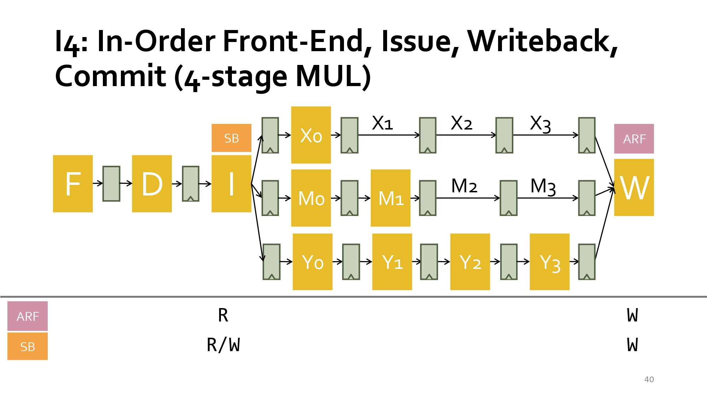

這張投影片主題為 「I4: In-Order Front-End, Issue, Writeback, Commit (4-stage MUL)」，進一步展示了引入Scoreboard（記分板）與ARF（架構暫存器檔案）機制後的完整順序管線結構。
- 本教學重點內容：
  - 結構組件與階段分工：
    - 前端階段（F, D, I）：除了取指（Fetch）與譯碼（Decode）外，獨立出 I (Issue，發射) 階段，並在此階段結合 SB (Scoreboard) 進行相依性檢查與暫存器讀取。
    - 多路執行單元：包含 2 階段算術路徑 ($X_0 \to X_1$)、4 階段記憶體路徑 ($M_0 \to \dots \to M_3$) 與 4 階段乘法路徑 ($Y_0 \to \dots \to Y_3$)。
    - 寫回階段（W）：將結果寫回 ARF (Architectural Register File)。
  - 硬體狀態維護機制（ARF vs. SB）：
    - ARF（架構暫存器檔案）：在 I 階段進行讀取（R），並在 W 階段進行寫入（W），儲存程式當前的實際架構狀態。
    - SB（記分板）：在 I 階段進行讀取與更新（R/W） 以檢查 hazard，並在 W 階段釋放狀態（W）。
- 個人看法： 這張投影片展現了硬體如何透過輕量化控制模組（Scoreboard）來管理具備非對稱延遲的多管線架構。
  - 優點：Scoreboard 能在 I 階段精確追蹤哪些暫存器正被長延遲運算（如 4-stage MUL）佔用，有效防範 RAW/WAW 等 Data Hazards 與 Writeback 競爭。
  - 局限：因為 Front-End 與 Issue 仍嚴格保持順序（In-Order），只要前方的指令被 SB 擋住（Stall），後方無相依性的指令也無法超越執行，硬體平行度的發揮仍受限於順序發射的本質。
- 總結：
   本投影片介紹結合 Scoreboard (SB) 與 ARF 的 4 階段乘法順序管線架構。重點說明在 Issue 階段利用 SB 進行動態相依性檢查與暫存器讀取，並於 Writeback 階段更新 ARF。此機制能精確管控多路執行路徑的 Hazards 與資源競爭，是向亂序執行（Out-of-Order）邁進的關鍵過渡設計。

## slide：41

  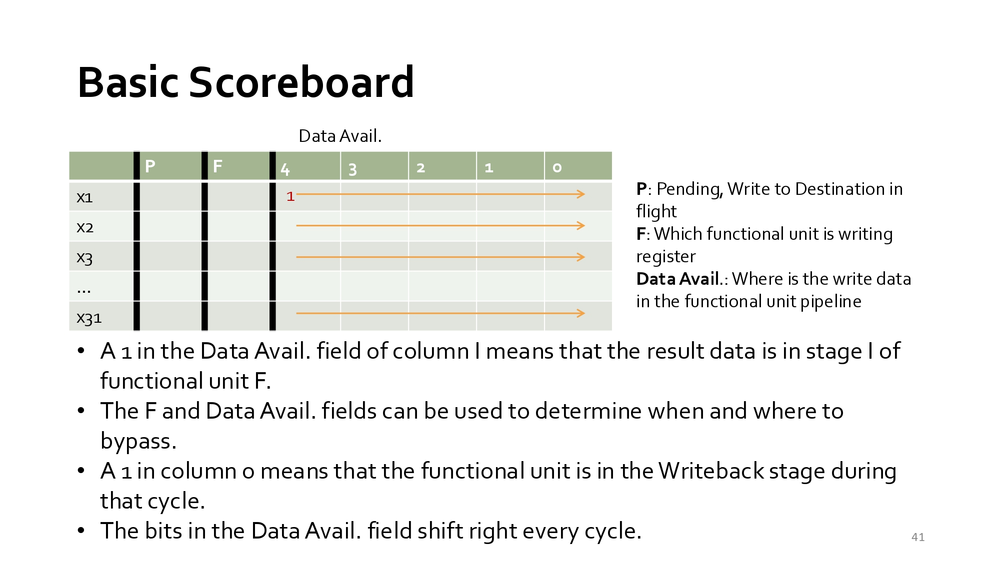

這張投影片主題為 「Basic Scoreboard（基礎記分板）」，詳細展示了 Scoreboard 控制邏輯的硬體結構與運作原理。
- 本教學重點內容：
  - 記分板表格欄位結構（Table Fields）：
    - P (Pending)：標示是否有指令正在執行中，且準備寫入該目標暫存器（In-flight）。
    - F (Functional Unit)：紀錄當前是由哪一個功能單元（Functional Unit）負責寫入該暫存器。
    - Data Avail. (Data Availability)：以 Bit-vector（如欄位 $4, 3, 2, 1, 0$）追蹤運算結果資料位於功能單元流水線的哪一階段。
  - 動態追蹤與旁路（Bypassing）機制：
    - 位置標示：Data Avail. 欄位中的 $1$ 代表結果資料當前處於該 Functional Unit 的第 $l$ 階段；若 $1$ 推進至 column 0，則表示該指令已進入 Writeback（寫回）階段。
    - 資料旁路仲裁：結合 F 與 Data Avail. 欄位資訊，系統能精確判定結果資料何時、何處可用，以控制旁路（Bypassing/Forwarding）線路的開啟 timing。
    - 時脈位移：每經過一個時脈週期（Cycle），Data Avail. 欄位中的 Bit 會向右位移（Shift right）一個位置，反映資料在管線中的推進。
- 個人看法： Scoreboard 是動態排程（Dynamic Scheduling）極為經典的控制心臟。
  - 優點：相較於完全靜態的編譯器排程，Scoreboard 透過簡單的狀態表（Bit-shifting）即可在硬體端動態追蹤多路流水線的資料進度，有效解決 Data Hazards 並控制 Bypassing 時機。
  - 局限：傳統 Scoreboard 通常僅追蹤 RAW hazard 與結構衝突；若沒有搭配暫存器重命名（Register Renaming）技術，在面對 WAW 或 WAR 衝突時仍需要 Stall 管線，這也是後續發展出 Tomasulo 演算法的重要動機。
- 總結：
   本投影片說明 Basic Scoreboard 的硬體結構與運算機制，利用 Pending (P)、Functional Unit (F) 及 Data Availability 欄位動態監控暫存器寫回狀態。透過狀態 Bit 每週期右移的特性，系統能精確仲裁資料旁路（Bypassing）時機並解除相依性停頓，是硬體動態排程與 hazard 控制的關鍵核心。

## slide：42

  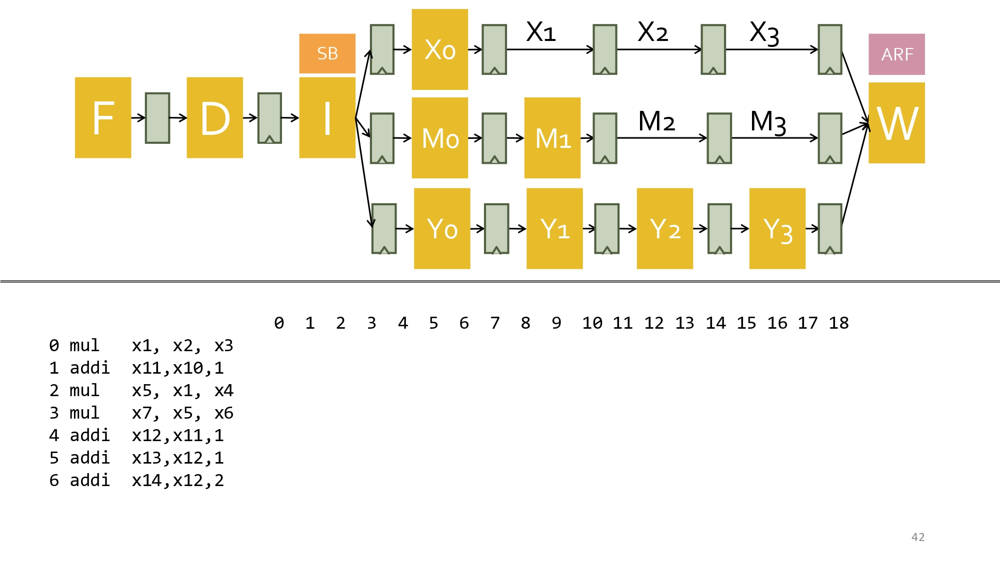

這張投影片主題為 Scoreboard 在包含長延遲單元（如 4-stage MUL）管線中的具體指令執行追蹤與模擬。
- 本教學重點內容：
  - 指令序列與相依性關係（Instruction Sequence & Hazards）：
    - 範例程式碼包含 7 條指令（0: mul, 1: addi, 2: mul, 3: mul, 4: addi, 5: addi, 6: addi）。
    - RAW 相依性（Data Hazard）：例如指令 2 (mul x5, x1, x4) 依賴指令 0 (mul x1, x2, x3) 的寫入結果 x1；指令 3 依賴指令 2 的 x5。
    - WAW / 資源衝突：不同長度的執行路徑（2-stage ALU vs 4-stage MUL）會導致後發射的短指令試圖與先發射的長指令在同一週期寫回，需要透過 Scoreboard 控制。
  - 時間軸模擬（Cycle-by-Cycle Execution Timeline）：
    - 投影片下方標示的數字 $0 \sim 18$ 代表時間軸（Clock Cycles）。
    - 透過這個架構，學生需要逐步推算每條指令進入 F（Fetch）、D（Decode）、I（Issue/Scoreboard Read）、EX/MEM/MUL 執行階段 與 W（Writeback） 的精確時脈週期。
- 個人看法：
   這是計算機架構課程中極為經典且重要的「手動管線追蹤（Pipeline Trace）」題目。
  - 教學目的：光看理論抽象概念（如 Scoreboard 結構）不足以理解細節，透過這種精確到 Clock Cycle 的模擬，能讓學生深刻體會到當發生 RAW/WAW hazard 時，Scoreboard 是如何動態發出 Stall（停頓）訊號，以及全旁路（Full Bypassing）硬體是如何省去等待週期。
  - 實務效益：理解這種非對稱管線的停頓與寫回衝突，是進一步邁向 Superscalar（超純量）與 Out-of-Order（亂序執行，如 Tomasulo 演算法）設計的核心基礎。   
- 總結：
   本投影片提供具備 4 階段乘法器與 Scoreboard 管線的時間軸模擬範例。透過包含資料相依性（如 x1, x5 的 RAW hazard）的 7 條指令序列，展示指令在時脈週期 $0 \sim 18$ 間的推移過程。重點在於驗證 Scoreboard 如何動態偵測 Hazards 並仲裁暫存器寫回與旁路時機。 

## slide：43

  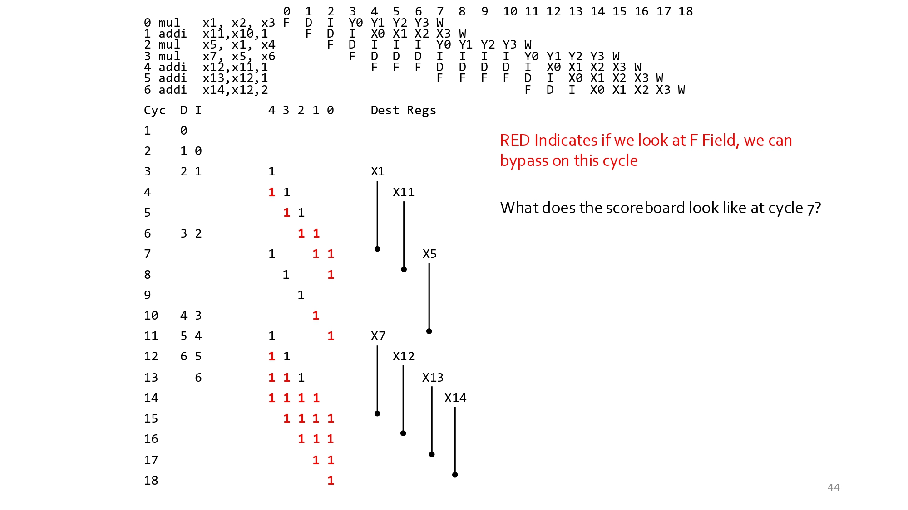

這張投影片展現了 Scoreboard（記分板）動態排程在具備多路非對稱執行管線（含 4 階段 MUL）中的實際運算日誌（Execution Trace）與狀態轉移。
- 本教學重點內容：
  - 具體指令序列的管線推移（Pipeline Flow）：
    - RAW Hazard（資料相依性）處理：例如指令 0 (mul x1, x2, x3) 產生的結果 x1 被指令 2 (mul x5, x1, x4) 依賴。投影片顯示指令 2 在 Issue (I) 階段停頓（Stall）多個週期（Cyc 4~6），直到指令 0 完成並進行旁路（Bypassing）才解鎖發射。
    - 多路發射與阻塞：後方無相依或有相依的指令（如 addi）受到前面指令停頓的影響，在 Decode (D) 或 Issue (I) 階段形成佇列等待。
  - 記分板內部狀態變化與旁路判定（Scoreboard State & Bypassing）：
    - 下方表格展示了每一週期（Cyc 1~18）Data Avail. 欄位位元陣列（Bit-vector）右移與目標暫存器（Dest Regs, 如 x1, x11, x5 等）標記的演變。
    - 紅色數字標示：代表透過檢查 F 欄位與 Data Avail. 狀態，硬體可以在該週期觸發資料旁路（Bypass），將運算結果直接 Forwarding 至需要該資料的功能單元，避免額外的寫回等待週期。
    - 提出的隨堂問題：「What does the scoreboard look like at cycle 7?」，要求分析在第 7 個週期時 SB 各欄位的數值狀態。
- 個人看法： **這張圖是整章微架構動態排程教學的最精髓精華**。
  - 實務價值：它透過文字化的流水線時間軸與表格狀態圖解，把「抽象的控制邏輯」轉化為「可驗證的演算法狀態演進」。讀者能清晰看到 Scoreboard 如何精確計算 Data Avail. 的位移（Shift）來抓準 Bypassing 時間點。
  - 瓶頸體會：從時間軸可以看出，即使引進了 Scoreboard 與 Bypassing，指令 2 仍因為前面長延遲的乘法運算而在 I 階段被卡住很久。這極大地凸顯了「In-Order Issue」的效能天花板，自然而然為後續引出「Out-of-Order Issue（如 Tomasulo 演算法與 Reservations Stations）」打下了最堅實的理論基礎。
- 總結：
   本投影片透過 7 條指令序列的 Cycle-by-Cycle 執行日誌，展示 Scoreboard 如何動態處理 RAW 資料相依與管線停頓。重點在於說明記分板利用位元位移追蹤 Data Avail.，並精確控制 Bypassing 觸發時機。此追蹤過程驗證了 Scoreboard 的動態排程能力，同時揭示了順序發射（In-Order Issue）面對長延遲運算時的瓶頸。

## slide：44

  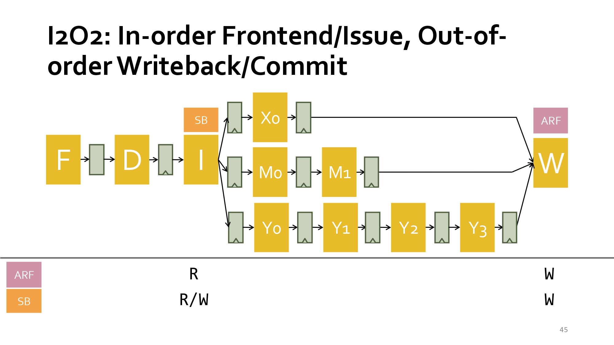

這張投影片主題為 「I2O2: In-order Frontend/Issue, Out-of-order Writeback/Commit」，展現了結合順序發射與亂序寫回（Commit）特性的微架構。
- 本教學重點內容：
  - 混合式管線架構模式（I2O2）：
    - In-order Frontend / Issue ($I_2$)：指令從 Fetch (F)、Decode (D) 到 Issue (I) 階段皆嚴格按照程式碼原始順序進行處理。
    - Out-of-order Writeback / Commit ($O_2$)：由於不同執行單元長度不一（例如 2 階段算術單元 $X_0 \to X_1$ vs. 4 階段乘法單元 $Y_0 \to \dots \to Y_3$），執行速度較快的短指令會超越先發射但執行慢的長指令，先一步算完並亂序寫回（Out-of-Order Writeback）暫存器。
  - 硬體狀態控制（Scoreboard + ARF）：
    - I 階段：讀取 ARF（架構暫存器檔案），同時對 Scoreboard (SB) 進行讀寫以實施相依性檢查。
    - W 階段：結果完成時，動態更新 ARF 並釋放 SB 狀態。
- 個人看法：
   I2O2 展現了處理器從純順序（In-Order）邁向完全亂序（Out-of-Order）的過渡設計。
  - 優點：前端設計簡單，且允許短指令不必死等前方慢速指令完成即可先寫回，提高了 execution pipeline 的運算效能。
  - 致命缺陷（精確中斷喪失）：由於寫回與提交是亂序的（Out-of-Order Commit），若後發射的短指令已經寫回更新了 ARF，而先發射的長指令此時突然觸發硬體異常（Exception），CPU 將無法還原至發生異常當下的精確狀態。這也是為什麼現代高效能處理器必須導入 ROB（Reorder Buffer） 來達成「亂序執行、順序提交（In-Order Commit）」。
- 總結：
   本投影片介紹 I2O2 架構，重點在於前端順序發射（In-Order Issue），但因多路執行管道長短不一，導致指令亂序寫回與提交（Out-of-Order Writeback/Commit）。此設計雖能提升多功能單元的吞吐量，但亂序更新 ARF 會破壞系統的「精確中斷（Precise Interrupt）」機制，凸顯了後續微架構需要 Reorder Buffer 來強制順序提交的必要性。

## slide：45

  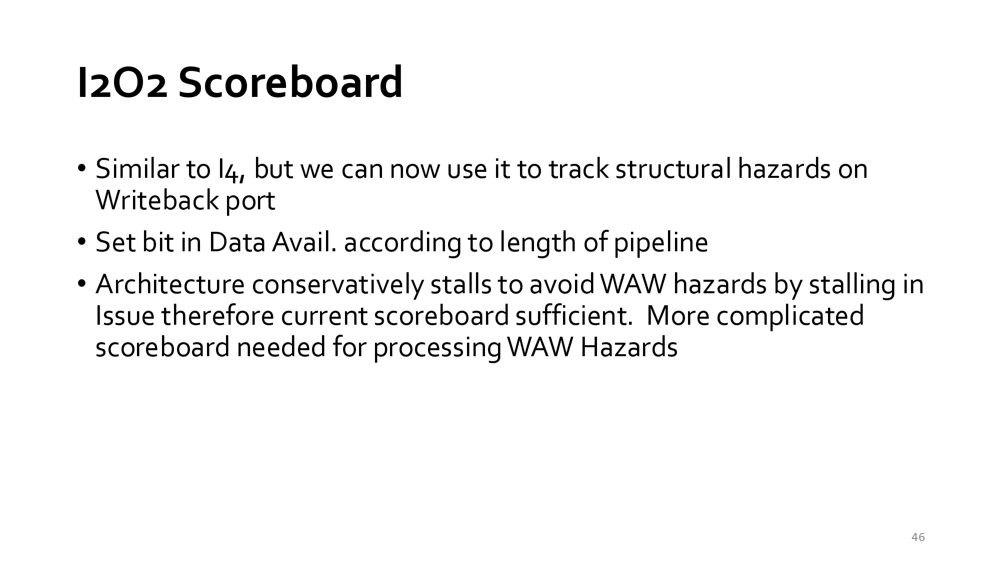

這張投影片說明 I2O2 架構下 Scoreboard（記分板）運作機制與控制限制。
- 本教學重點內容：
  - 功能與結構承襲：
    - 基本運作與 I4 架構類似，但可用於追蹤寫回埠（Writeback Port）上的結構衝突（Structural Hazards）。
    - 根據各功能單元管線的長度（Length of Pipeline），動態設定 Data Avail. 欄位中的位元。
  - WAW Hazards（寫後寫衝突）的處理機制：
    - 保守停頓策略：此架構透過在 Issue（發射）階段保守地暫停（Stall）指令來避免 WAW 衝突，因此當前的 Basic Scoreboard 結構已足夠使用。
    - 複雜度開銷：若要在允許發射後再動態處理解決 WAW 衝突，則需要更複雜的 Scoreboard 設計。
- 個人看法：
   這反映了微架構設計在「硬體複雜度」與「執行效能」之間的權衡（Trade-off）。
  - 優點：藉由在 Issue 階段直接 Blocking 掉可能產生 WAW 的指令，硬體可以用非常輕量、精簡的 Scoreboard 控制邏輯（Basic Scoreboard）維護寫回正確性，省去複雜的重命名或佇列機制。
  - 瓶頸：保守的 Stall 會產生不必要的流水線停頓，降低指令平行度（ILP）；這說明了為什麼更進階的 CPU 會採用暫存器重命名（Register Renaming）技術（如 Tomasulo 演算法）來徹底消除 WAW/WAR 假性相依，進而解放性能上限。
- 總結：
   本投影片說明 I2O2 架構下的 Scoreboard 機制，其透過設定 Data Avail. 位元追蹤 Writeback 埠的結構衝突。為確保正確性，系統選擇在 Issue 階段保守停頓指令以防範 WAW 衝突，使 Basic Scoreboard 足以應付需求。此折衷設計降低了硬體複雜度，但也暴露了順序發射限制 ILP 的效能瓶頸。

## slide：46

  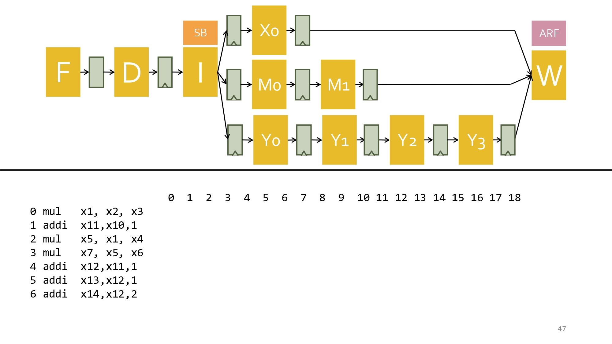

這張投影片展現了與上一頁相同結構的 I2O2（順序發射 / 亂序寫回） 架構，並著重於範例指令序列的執行追蹤。
- 本教學重點內容：
  - I2O2 範例追蹤架構模型：
    - 前端保持順序（In-Order Fetch/Decode/Issue），並由 Scoreboard (SB) 進行動態檢查。
    - 多路平行執行路徑包含 2 階段 ALU ($X_0 \to X_1$)、4 階段 Memory ($M_0 \to \dots \to M_3$) 與 4 階段 Multiplier ($Y_0 \to \dots \to Y_3$)。
    - 各單元算完後可亂序寫回（Out-of-Order Writeback）至 ARF。
  - 追蹤目標（Cycle-by-Cycle Trace）：
    - 提供相同的 7 條指令序列（包含 mul 與 addi），供學生比對在 I2O2 亂序寫回 模式下，指令於時脈週期 $0 \sim 18$ 的推移情況與 I4 順序寫回架構有何差異。
- 個人看法：
   對比上一節課的 I4（順序寫回），I2O2 讓短指令（如 addi）能提早於慢速指令（如 mul）前完成寫回（Out-of-Order Commit）。
  - 效能提升：減少了短指令在寫回階段被慢速指令卡住的 stall 時間，提高 pipe 吞吐量。
  - 設計隱憂：亂序寫回破壞了「精確中斷（Precise Interrupt）」。當較晚發射的短指令已寫回暫存器，而較早發射的慢指令突然發生硬體 Exception 時，CPU 狀態將無法完美復原，這促成了後續 Reorder Buffer (ROB) 架構的誕生。
- 總結：
   本投影片提供 I2O2（順序發射、亂序寫回）管線的指令追蹤範例。重點在於展示多路執行單元如何讓短指令超越長延遲指令先一步完成寫回，以提升運算效率。然而此設計破壞了精確中斷機制，亦引出了現代 CPU 導入 ROB 實現順序提交的必要性。

## slide：47

  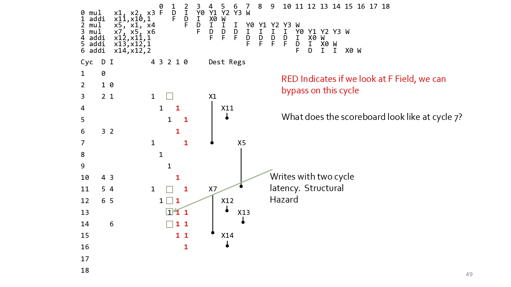

這張投影片呈現了一張詳細的 Scoreboard（計分板）時序追蹤圖，展示多條指令在帶有分數板（Scoreboard）與 Data Forwarding/Bypassing 的流水線中動態排程與執行的狀況。
- 本教學重點內容：
  - 指令序列與執行階段時序圖（頂部表格）：
    - 指令序列與延遲：
      - 0 mul x1, x2, x3：需要多週期（Y0, Y1, Y2, Y3）
      - 1 addi x11, x10, 1：單週期（X0）
      - 2 mul x5, x1, x4：因相依於 x1，需停頓等待 x1 資料就緒（RAW Hazard）
      - 3 mul x7, x5, x6：因相依於 x5，需停頓等待 x5 資料就緒
      - 4 addi x12, x11, 1 / 5 addi x13, x12, 1 / 6 addi x14, x12, 2：後續相依的加法指令
    - 時序欄位意義：
      - F：Fetch（取指）
      - D：Decode / Issue（解碼與發射）
      - I：Wait for Read Operands（等待運算元就緒/停頓）
      - X0 / Y0~Y3：Execute（執行階段，Y0~Y3 代表長延遲的乘法運算）
      - W：Writeback（寫回暫存器）
  - Scoreboard 狀態變革（底部週期表格：Cyc 1~18）：
    - 欄位：Cyc（週期）、D（當前 Decode 階段指令）、I（當前 Issue/Ready 指令）、Dest Regs（目前有 Pending Write 的目標暫存器）。
    - 紅色數字（RED）：代表若觀察 F 欄位（Forwarding），該週期可以透過 Bypassing / Data Forwarding 直接將結果傳遞給後續指令，無需停頓寫回。
    - 關鍵問題：What does the scoreboard look like at cycle 7?（在週期 7 時，Scoreboard 的狀態為何？）
      - 在週期 7，指令 0 (mul x1) 正好完成 Y3 階段並在寫回，x1 準備寫回，而指令 2 (mul x5) 正在等待 x1 釋放。
  - 結構衝突（Structural Hazard）：
    - 下方標註 Writes with two cycle latency. Structural Hazard：當多條不同延遲的指令同時試圖在同一個週期寫回暫存器，或存取同一個 Write Port 時，會引發結構衝突（Structural Hazard）。
- 個人看法：
   這張投影片是理解 Scoreboard 與 Data Forwarding 如何交錯運作 的深度範例：
  - Data Forwarding 解開 RAW Hazard：
     紅色數字標示了 Bypassing 成立的時間點。如果沒有 Data Forwarding，指令必須等到 W（Writeback）階段完全結束才能讀取暫存器；但透過 Bypassing，在 EX 階段結束（如 Y3 或 X0）的下一週期，運算結果就能直接拉線送到下一個 ALUs 的輸入端。
  - Scoreboard 的核心任務：
     Scoreboard 必須精確記錄哪些暫存器目前「被佔用（Pending Write）」（如圖中的 Dest Regs: X1, X11, X5...），並控制何時解除 Stall，確保指令只在運算元真正就緒時才進入 Execute 階段。
- 總結：
   本投影片透過逐週期的 Scoreboard 追蹤圖，展現了 Scoreboard 硬體如何動態鎖定目標暫存器（Dest Regs）、處置 RAW 資料相依，並結合 Bypassing（紅色標記）盡可能縮短管道停頓週期，同時處理因不同指令延遲產生的 Structural Hazard。

## slide：48

  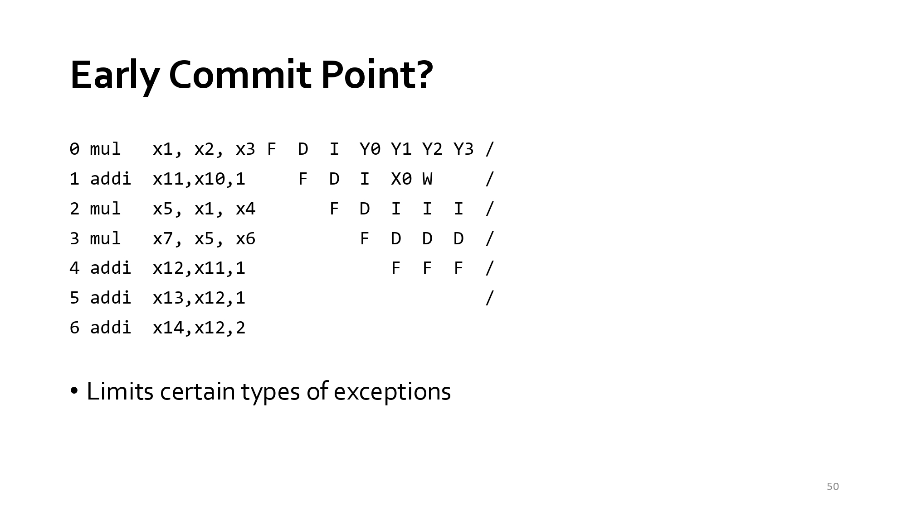

這張投影片主題為 「Early Commit Point?（過早提交點的隱患）」，探討如果在管線設計中讓指令在尚未徹底完成檢查時就過早進行提交（Early Commit），將對系統引發的嚴重後果。
- 本教學重點內容：
  - 時序範例與執行過程（Pipeline Schedule）：
    - 指令 0：0 mul x1, x2, x3 $\rightarrow$ 在發射與執行時經歷多個週期（Y0 ~ Y3）。
    - 指令 1：1 addi x11, x10, 1 $\rightarrow$ 執行時間短（X0），很快就完成了運算並到達寫回（W）階段。
    - 指令 2：2 mul x5, x1, x4 $\rightarrow$ 正在停頓（I）等待 x1。
  - 核心問題（Early Commit Point）：
    - 在此排程中，較晚進管線的指令 1 (addi) 比較早進管線的指令 0 (mul) 更快執行完畢並寫回（W）。
    - 如果微架構在指令 1 執行完（X0）時就直接允許其 Commit（寫回暫存器/更新架構狀態），這就是所謂的 Early Commit。
  - 引發的限制與後果（Limits Certain Types of Exceptions）：
    - 破壞精確例外（Precise Exceptions）：如果在週期 $t$，指令 1 (addi) 已經 Commit 寫入暫存器，但指令 0 (mul) 隨後在 Y3 階段發生了 Arithmetic Overflow 或 Data Exception，硬體將無法復原指令 1 已經造成的狀態改變！
    - 限制例外類型：這種「早提交」的架構會限制 CPU 支援精確例外的能力，迫使系統只能支援特定非精確（Imprecise）的 Exception 類型，或者嚴重限制管線的動態排程能力。
- 個人看法：
   這張投影片用最直觀的時序反例，完美解釋了為什麼現代處理器需要 In-Order Commit（按序提交） 機制：
  - 亂序執行（OOO）與按序提交（In-Order Commit）的必然性：
    - 指令可以亂序執行（指令 1 比指令 0 先算完），但絕不能亂序提交！
    - 如果允許 Early Commit，處理器就會倒退回前幾張投影片提到的 $I_2 O_2$ 障礙（無法維持 Precise Exceptions）。
  - Reorder Buffer (ROB) 的誕生動機：
     為了阻止指令 1 這種「跑得快就想先 Commit」的行為，硬體必須引入 ROB。指令 1 算完後只能先把結果存在 ROB 緩衝區裡「排隊」，一定要等到前面的指令 0 順利 Commit 且確定沒有 Exception 後，指令 1 才能正式 Commit 寫回暫存器。
- 總結：
   本投影片強調了「過早提交（Early Commit）」對精確例外的破壞性：當長延遲指令（如乘法）後方的短延遲指令（如加法）過早 Commit 時，一旦長延遲指令後續發生 Exception，將無法撤銷已 Commit 的狀態。這也是為什麼現代微架構必須採用 Reorder Buffer (ROB) 來強制實現 In-Order Commit 的核心原因。

## slide：49

  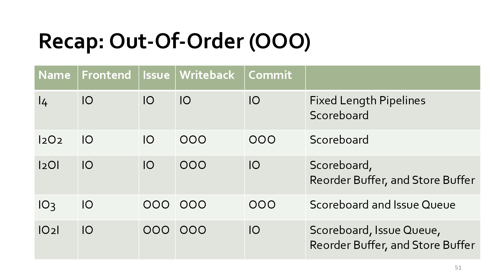

這張投影片為亂序執行微架構（Out-Of-Order Architectures）的分類總結表（Recap Table），透過將指令週期的四個核心階段分為「按序（In-Order, IO）」或「亂序（Out-Of-Order, OOO）」，歸納出不同硬體架構的演進與特性。
- 本教學重點內容：
  - 表格欄位與階段定義：
    - Frontend：取指與初步處置
    - Issue：發射與檢查運算元
    - Writeback：運算完成並將結果寫回暫存器/內部緩衝區
    - Commit：正式更新架構狀態（Architectural State）
  - 五種典型微架構分類：
    |架構名稱  |Frontend  |Issue  |Writeback  |Commit  |典型硬體元件與特徵   |
    |--|--|--|--|--|--|
    |$I_4$  |IO  |IO  |IO  |IO  |固定長度流水線，搭配 Scoreboard。全按序執行。|
    |$I_2O_2$  |IO  |IO  |OOO  |OOO  |Scoreboard。按序發射，但因執行時間不同而亂序寫回與提交，無法支援精確例外（Imprecise Exceptions）。|
    |$I_2OI$  |IO|IO|OOO|IO|Scoreboard, Reorder Buffer (ROB), Store Buffer。按序發射、亂序寫回至 ROB、按序提交（In-Order Commit），成功解決精確例外問題。|
    |$IO_3$  |IO  |OOO  |OOO|OOO|Scoreboard, Issue Queue。允許亂序發射與執行，但缺乏按序提交機制。|
      |$IO_2I$  |IO  |OOO  |OOO|IO  |Scoreboard, Issue Queue, Reorder Buffer, Store Buffer。現代高效能 CPU（如 Core i7, Zen）的標準架構，實現完全動態亂序執行，同時維持按序提交以確保精確例外。|
  - 命名邏輯（Naming Scheme）：
    - $I$ 代表 In-Order（按序）；$O$ 代表 Out-Of-Order（亂序）。
    - 字母數字交替代表各階段的開關狀態，例如：
      - $I_2OI$：前 2 階段為 IO，第 3 階段為 OOO，第 4 階段為 IO。
      - $IO_2I$：第 1 階段為 IO，中間 2 階段為 OOO，最後 1 階段為 IO。
- 個人看法：
   這張表格是計算機結構中亂序執行演進史的最精華整理：
  - $I_2O_2$ 到 $I_2OI$ 的關鍵轉折：
    - 早期的 CDC 6600（Scoreboard）採用 $I_2O_2$，雖然獲得了指令平行的好處，卻犧牲了精確例外。
    - 引入 ROB (Reorder Buffer) 轉變為 $I_2OI$ 是關鍵的一步，它奠定了「亂序執行、按序提交（Execute Out-of-Order, Commit In-Order）」的基本原則。
  - 終極型態 $IO_2I$：
     加入 Issue Queue（或 Reservation Station） 後升級為 $IO_2I$，真正釋放了指令級平行度（ILP），讓管線擺脫了前端因單一指令停頓而造成的阻塞（Head-of-Line Blocking）。
- 總結：
   本投影片統整了微架構演進的五種模式，說明現代高效能處理器之所以能兼具極致效能與穩定例外處理，關鍵就在於採用 $IO_2I$ 架構：利用 Issue Queue 實現動態亂序發射與執行，並透過 Reorder Buffer (ROB) 強制執行按序提交（In-Order Commit）。 

## slide：50

  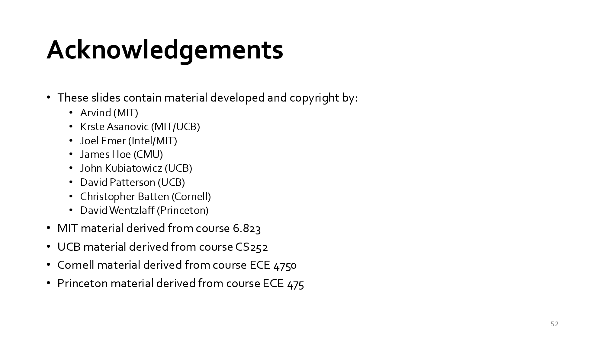

這張投影片主題為 「Acknowledgements（致謝與教材來源）」，列出了本課程投影片所引用或改編的各大名校教材來源與學者名單。
- 本教學重點內容：
  - 版權與教材開發者名單（Material Developed and Copyright by）：
    - Arvind (MIT)
    - Krste Asanovic (MIT/UCB)
    - Joel Emer (Intel/MIT)
    - James Hoe (CMU)
    - John Kubiatowicz (UCB)
    - David Patterson (UCB) —— 圖靈獎得主、RISC 架構與 Hennessy & Patterson 經典教科書作者之一。
    - Christopher Batten (Cornell)
    - David Wentzlaff (Princeton)
  - 引用的頂尖大學課程（Derived Course Materials）：
    - MIT 6.823：麻省理工學院的高級計算機結構課程（Computer System Architecture）。
    - UCB CS252：加州大學柏克萊分校的研究生級計算機結構課程（Graduate Computer Architecture）。
    - Cornell ECE 4750：康奈爾大學的計算機架構課程（Computer Architecture）。
    - Princeton ECE 475：普林斯頓大學的計算機系統架構課程。
- 總結：
   本張投影片為本章節（Traps, Pipeline Flush & Out-of-Order Execution）的完結頁面，說明了這套課程講義融合了 MIT、UC Berkeley、Cornell 與 Princeton 等頂尖學府在計算機結構領域的精華教材與學術成果。

