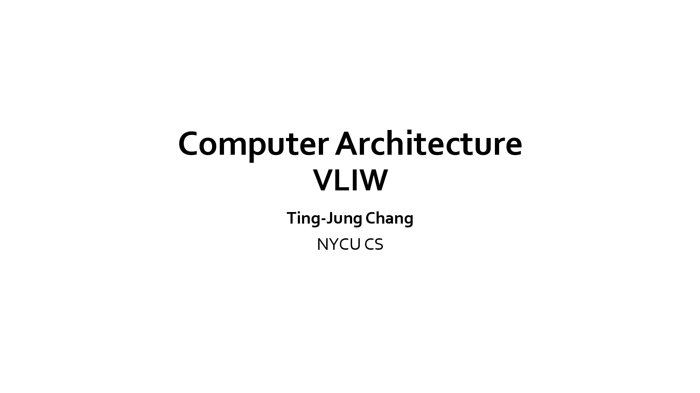
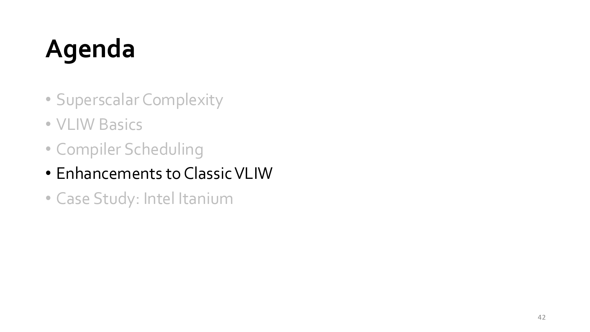
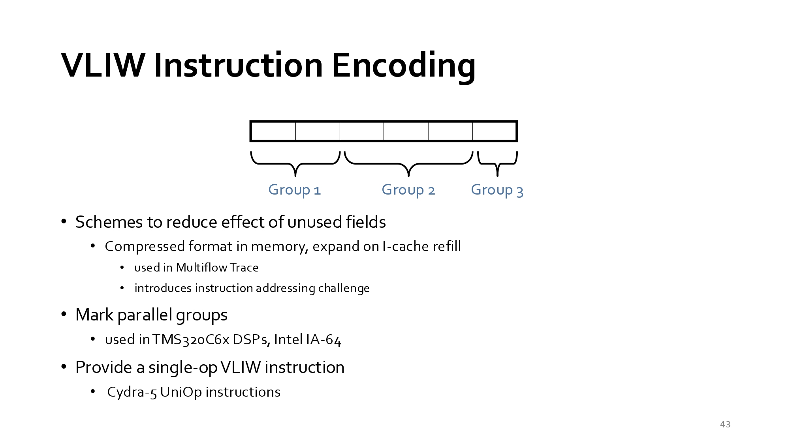
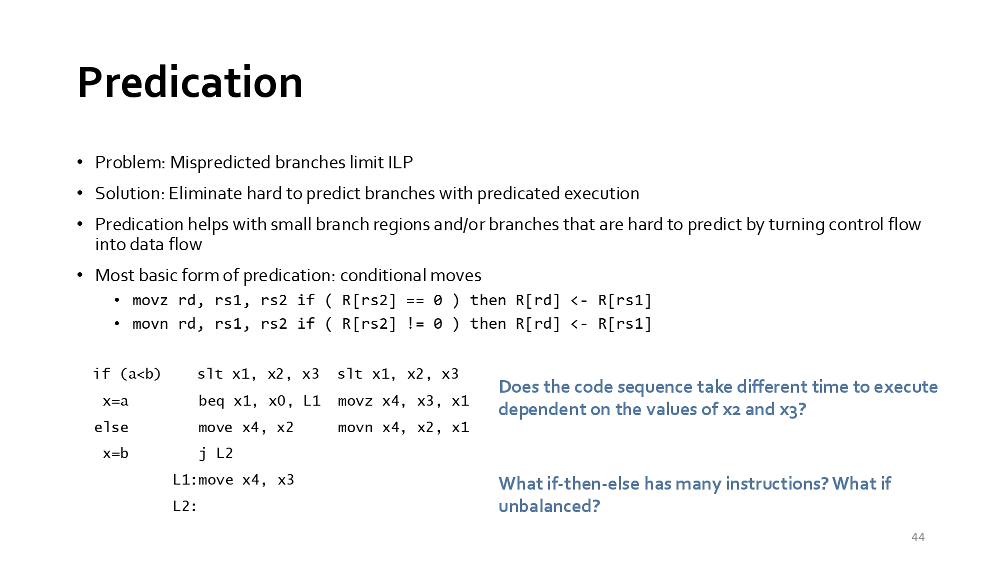
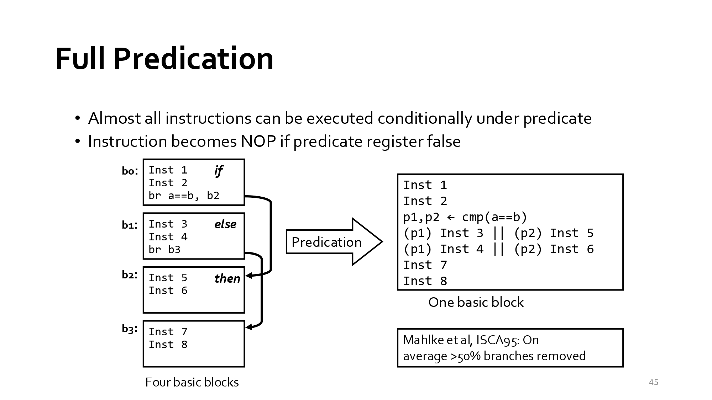

### Week 5 (2026-10-06)課堂逐字稿
#### 教學資源：
- [SD5.pdf](./Lecture/SD5.pdf)
- Lecture Recording:
  - Password for the video: 2026CompArch!
  - Superscalar complexity [video](https://nycu1-my.sharepoint.com/:v:/g/personal/tingjung_m365_nycu_edu_tw/IQCVuX_3NbKNQLbl4tEx19evAU0dgQovPnVaEb7VCiG_-us)
  - Classic VLIW [video](https://nycu1-my.sharepoint.com/:v:/g/personal/tingjung_m365_nycu_edu_tw/IQCpEPt6mBWJTq-_gttxWfyEAdn6B_fzmIdQ7bfAa2jU9YI?nav=eyJyZWZlcnJhbEluZm8iOnsicmVmZXJyYWxBcHAiOiJTdHJlYW1XZWJBcHAiLCJyZWZlcnJhbFZpZXciOiJTaGFyZURpYWxvZy1MaW5rIiwicmVmZXJyYWxBcHBQbGF0Zm9ybSI6IldlYiIsInJlZmVycmFsTW9kZSI6InZpZXcifX0%3D&e=8I7Yrw)
  - Itanium: Intel’s Great Successor [video](https://youtu.be/-K-IfiDmp_w?si=opXOIb5hF0O0xO-6)
  - Reference: 
    - H&P6 218 - 222
    - H&P6 Appendix H
- Prompt：
  - 請將本教學內容英/中翻譯比對
  - 請說明本slide教學重點內容及你的看法，最後以250字內總結
- [Week 5 (2026-10-06)課堂逐字稿](week-5-2026-10-06課堂逐字稿-1)
  - [slide：3 Agenda | 課程大綱 / 議程](#slide3-agenda--課程大綱--議程)
  - [slide：4 Exploiting ILP (Instruction-Level Parallelism) | 挖掘指令級平行度（ILP）](#slide4-exploiting-ilp-instruction-level-parallelism--挖掘指令級平行度ilp)
  - [slide：5 Reprise of Dynamic Scheduling | 重溫動態排程（Dynamic Scheduling）](#slide5-reprise-of-dynamic-scheduling--重溫動態排程dynamic-scheduling)
  - [slide：6-7 Superscalar Control Logic Scaling | 超純量控制邏輯的擴充性/規模化問題](#slide6-7-superscalar-control-logic-scaling--超純量控制邏輯的擴充性規模化問題)
  - [slide：7 Superscalar Control Logic Scaling | 超純量控制邏輯的擴充性/規模化問題](#slide7-superscalar-control-logic-scaling--超純量控制邏輯的擴充性規模化問題)
  - [slide：8 Out-of-Order Control Complexity: MIPS R10000 | 亂序執行的控制複雜度實例](#slide8-out-of-order-control-complexity-mips-r10000--亂序執行的控制複雜度實例)
  - [slide：9 順序指令集架構（Sequential ISA）的瓶頸](#slide9-順序指令集架構sequential-isa的瓶頸)
  - [slide：10 超純量編譯器（Superscalar Compiler）](#slide10-超純量編譯器superscalar-compiler)

## 知識點：
- [Superscalar Complexity（超純量架構複雜度）](#superscalar-complexity超純量架構複雜度)
- [VLIW（Very Long Instruction Word，超長指令字）](https://github.com/414551016/Computer-Architecture/blob/main/SD5-2_VLIW%20Basics.md#vliwvery-long-instruction-word%E8%B6%85%E9%95%B7%E6%8C%87%E4%BB%A4%E5%AD%97)
- [Week 5 (2026-10-06)課堂逐字稿]{}

### VLIW（Very Long Instruction Word，超長指令字）
- Computer Architecture | 電腦架構
- VLIW（Very Long Instruction Word，超長指令字） 是一種利用**指令級平行化（Instruction-Level Parallelism, ILP）**的處理器架構。
<br>其核心思想是：由編譯器負責找出可同時執行的指令，並將多個操作封裝成一個超長指令，讓 CPU 在同一個 Clock Cycle 同時執行。
- 傳統處理器：
  ```
  一般 RISC-V 指令：
    add x1,x2,x3
    sub x4,x5,x6
    mul x7,x8,x9
  CPU 一次取出一條指令：
    Cycle 1 → add
    Cycle 2 → sub
    Cycle 3 → mul
    ``
  ```
- VLIW 處理器：
  ```
  編譯器將可平行執行的指令組合：形成一個超長指令字（Instruction Word）。
    | add | sub | mul |
  執行時：三個功能單元同時工作。
    Cycle 1
    ├─ add
    ├─ sub
    └─ mul
  ```
- VLIW 的特色
  - 平行化由編譯器決定：
    - 傳統 Superscalar CPU：硬體找平行性
    - VLIW：編譯器找平行性，因此硬體較簡單。
  - 指令字較長：
    - 例如：128-bit、256-bit、512-bit
    - 一個指令字可能包含：ALU指令、Load指令、Store指令、Branch指令，同時發射（Issue）。
  - 多功能單元
    - ALU1、ALU2、Multiplier、Load/Store Unit 可同時運作。

- VLIW（Very Long Instruction Word）是一種利用指令級平行化的處理器架構，其特色是由編譯器在編譯期間分析指令相依性，並將多條可同時執行的指令打包成單一超長指令字，使多個執行單元能在同一個時脈週期內平行運作。與 Superscalar 處理器由硬體動態發掘平行性不同，VLIW 將複雜度轉移至編譯器，因此硬體設計較簡單、功耗較低。然而其效能高度依賴編譯器最佳化能力，且程式相容性較差。VLIW 是研究指令級平行化（ILP）與平行處理器設計的重要代表架構。


# Week 5 (2026-10-06)課堂逐字稿

## slide：42 Enhancements to Classic VLIW | 傳統 VLIW 架構之強化與改進
<div align="left" >
  
  
</div>

- 教學內容英/中翻譯比對：
  <br>Agenda（課程大綱 / 議程）
  - Superscalar Complexity | 超純量架構的複雜度
  - VLIW Basics | 超長指令字（VLIW）基本概念
  - Compiler Scheduling | 編譯器排程技術
  - Enhancements to Classic VLIW | 傳統 VLIW 架構之強化與改進
  - Case Study: Intel Itanium | 案例研究：Intel Itanium 處理器
- 教學重點內容：
- 我的看法與補充：
- 內容總結：

## slide：43
<div align="left" >
  
</div>

- 教學內容英/中翻譯比對：
- 教學重點內容：
- 我的看法與補充：
- 內容總結：


## slide：44
<div align="left" >
  
</div>

- 教學內容英/中翻譯比對：
- 教學重點內容：
- 我的看法與補充：
- 內容總結：

## slide：45
<div align="left" >
  
</div>

- 教學內容英/中翻譯比對：
- 教學重點內容：
- 我的看法與補充：
- 內容總結：


