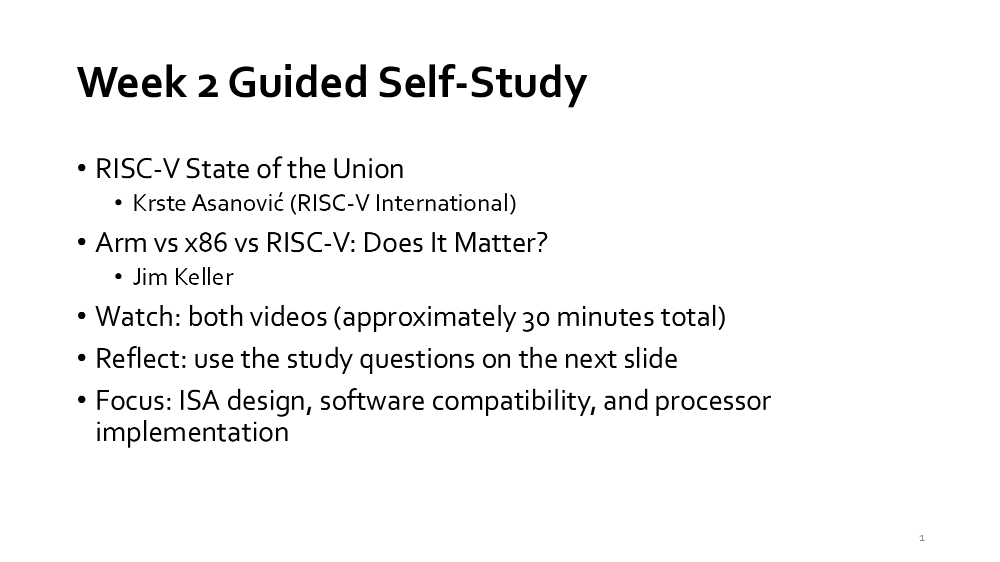
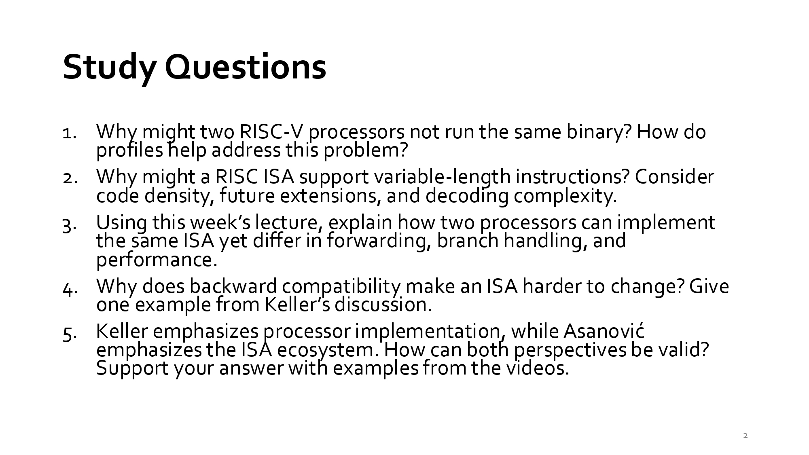

# Week2 Study Questions
## 教學資源：
- [［w2_selfstudy.pdf］](https://github.com/414551016/Computer-Architecture/blob/main/Lecture/w2_selfstudy.pdf)
- Prompt：
  - 請將內容以英/中翻譯對照說明，並說明教學重點內容及你的看法，最後以250字內總結
  - 請將每題內容先以英/中翻譯對照，再以簡答方式回答重點

## slide：1 Agenda | 課程大綱 / 議程

  

Week 2 Guided Self-Study | 第 2 週引導式自學
- RISC-V State of the Union — Krste Asanović (RISC-V International)
  > RISC-V 發展現況報告 — Krste Asanović（RISC-V 國際組織）
- Arm vs x86 vs RISC-V: Does It Matter? — Jim Keller
  > Arm vs x86 vs RISC-V：指令集架構重要嗎？ — Jim Keller
- Watch: both videos (approximately 30 minutes total)
  > 觀看：兩支影片（總計約 30 分鐘）
- Reflect: use the study questions on the next slide
  > 反思：使用下一頁的思考問題進行討論
- Focus: ISA design, software compatibility, and processor implementation
  > 重點：指令集架構（ISA）設計、軟體相容性以及處理器實作

教學重點內容：
- 二進位相容性與 Profiles 機制（Software Compatibility & Profiles）：
  - 問題：RISC-V 採用高度模組化設計（Base + Extensions），若兩顆處理器支援的擴充指令集組合不同，就無法執行相同的二進位檔。
  - 解決方案：RISC-V 國際組織引進 Profiles（例如 RVA22、RVA23），強制規範應用處理器必須支援的指令集組合與功能，以確保作業系統與應用軟體能在不同廠商的晶片間無縫移植。
- 可變長度指令設計（Variable-Length Instructions）：
 - 程式碼密度（Code Density）：引入 16-bit 壓縮指令（RVC）可顯著減少程式碼體積與記憶體頻寬需求。
 - 未來擴充性（Future Extensions）：保留空間給 48-bit、64-bit 或更長的專用擴充指令。
 - 解碼複雜度（Decoding Complexity）：雖然提高程式碼密度，但可變長度會增加微架構在 Fetch/Decode 階段尋找指令邊界的複雜度。
- ISA 設計對比與處理器實作（ISA Design vs Implementation）：
 - 根據 Jim Keller 等專家觀點，指令集架構（x86, Arm, RISC-V）本身只是一套軟硬體介面合約，決定處理器效能與功耗的核心關鍵在於微架構（Microarchitecture）實作與執行管線設計。

我的看法：
 RISC-V 的「開源與模組化」是雙面刃：它賦予晶片設計者極高自由度來針對 AI 與專用計算（DSA）進行客製化，但同時也面臨生態系碎片化的挑戰。RISC-V 推出 Profile 機制是走向通用計算（PC/伺服器）非常關鍵的一步。此外，可變長度指令雖然稍微增加了硬體解碼器的負擔，卻能換取寶貴的記憶體頻寬與未來擴充性，體現了現代精簡指令集（RISC）在硬體複雜度與軟體效率之間的折衷哲學。
 本週自學重點為 ISA 設計、軟體相容性與處理器實作。RISC-V 憑藉開源與模組化特色快速崛起，但其自由擴充特性易導致軟體碎片化，需透過 Profile 規範標準組合以確保二進位相容性。在指令設計上，支援可變長度指令能有效提高程式碼密度並保留未來擴充空間，雖略微增加解碼複雜度，卻能在記憶體頻寬上獲得優勢。而 x86、Arm 與 RISC-V 的對比則揭示：ISA 僅為軟硬體介面，晶片最終的性能與功耗差異本質上仍取決於微架構實作的優劣。

## slide：2 Agenda | 課程大綱 / 議程

  

### 第 1 題：
Why might two RISC-V processors not run the same binary? How do profiles help address this problem?
> 為什麼兩顆 RISC-V 處理器可能無法執行相同的二進位檔？Profile（規範）如何協助解決此問題？

簡答重點：
- 原因： RISC-V 採用模组化架構（基礎指令集 + 選擇性擴充功能），若兩顆處理器支援的擴充指令集（如 Vector、Vector/FP 等）組合不一致，即無法執行相同的二進位檔。
- Profiles 作用： Profiles（如 RVA22、RVA23）定義了特定應用領域（如 Linux OS）必須具備的標準指令集與功能集合，強制軟硬體遵循統一標準，以確保二進位相容性。

### 第 2 題：
Why might a RISC ISA support variable-length instructions? Consider code density, future extensions, and decoding complexity.
> 為什麼 RISC 指令集架構（ISA）會支援可變長度指令？請從程式碼密度、未來擴充性及解碼複雜度來考量。

簡答重點：
- 程式碼密度（Code Density）： 允許使用較短的指令（如 16-bit 壓縮指令），能有效減少程式碼體積與記憶體頻寬需求。
- 未來擴充性（Future Extensions）： 為長指令（如 48-bit、64-bit 或更長的 Vector/DSA 指令）預留編碼空間，便於擴充新功能而不受限於固定長度。
- 解碼複雜度（Decoding Complexity）： 缺點是增加硬體解碼器的負擔，因為處理器在 Fetch/Decode 階段需額外邏輯來判斷指令邊界。

